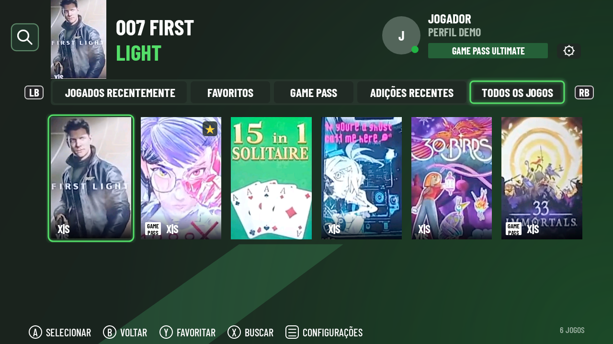

<div align="center">
  
  <h1>xCLOUD</h1>
  <p><strong>Seus jogos. Na sua tela.</strong></p>
  <p>Cliente Android independente para Xbox Cloud Gaming, com interface para TV e transmissão nativa.</p>
  <p>
    <a href="https://github.com/Ricardex742/TCL-xCloud-Nativo/actions/workflows/build-apk.yml?query=branch%3Aci%2Fapk-android10-3cc2595"></a>
    
    
  </p>
  <p><a href="#baixar-e-instalar">Baixar</a> · <a href="#telas-do-aplicativo">Telas</a> · <a href="#controles-de-toque-por-jogo">HUDs de toque</a> · <a href="#funcionalidades">Funcionalidades</a> · <a href="#atalhos-dos-jogos-na-tv">Atalhos na TV</a> · <a href="#compilar">Compilar</a></p>
</div>



## Telas do aplicativo

<table>
  <tr>
    <td width="50%"><br /><strong>Login</strong> — acesso à conta Microsoft.</td>
    <td width="50%"><br /><strong>QR Code</strong> — autorização pelo celular.</td>
  </tr>
  <tr>
    <td><br /><strong>Fila</strong> — estimativa do serviço e etapas da conexão.</td>
    <td><br /><strong>Configurações</strong> — preferências salvas no aparelho.</td>
  </tr>
  <tr>
    <td><br /><strong>Vídeo</strong> — menor atraso, adaptativo ou compatibilidade.</td>
    <td><br /><strong>Partida</strong> — ajustes, estatísticas e desconexão.</td>
  </tr>
  <tr>
    <td><br /><strong>Controles</strong> — coop local, vibração e toque.</td>
    <td><br /><strong>Imagem</strong> — nitidez e saturação durante a partida.</td>
  </tr>
</table>

As telas de interface são capturas das views nativas com perfil e dados de demonstração. O QR Code é ilustrativo. Capas e selos exibidos no uso real dependem dos dados oficiais do catálogo.

### Gameplay


Trecho de uma gravação de gameplay no aplicativo, com o enquadramento recortado para mostrar somente o jogo. A imagem não representa uma medição de fluidez ou desempenho.

## Controles de toque por jogo

No celular, escolha **Jogar com toque • HUD** ao abrir um jogo. O aplicativo seleciona um layout para Fortnite, Call of Duty, Forza, EA SPORTS FC/FIFA e Hades, além de perfis gerais de tiro, corrida, futebol e ação. Os demais títulos usam o controle Xbox virtual; qualquer jogo permite escolher outro layout manualmente.

<table>
  <tr>
    <td width="50%"><br /><strong>Fortnite</strong> — movimento, câmera por arrasto, tiro e troca de armas.</td>
    <td width="50%"><br /><strong>Construção</strong> — parede, rampa, piso e teto com comandos Builder Pro.</td>
  </tr>
  <tr>
    <td><br /><strong>Tiro</strong> — mirar, disparar, recarregar, agachar e granadas.</td>
    <td><br /><strong>Corrida</strong> — direção, acelerador, freio e marchas.</td>
  </tr>
  <tr>
    <td><br /><strong>Futebol</strong> — passe, chute, enfiada, corrida e fintas.</td>
    <td><br /><strong>Hades</strong> — ataque, especial, feitiço e esquiva.</td>
  </tr>
  <tr>
    <td><br /><strong>Ajustes</strong> — layout, tamanho, opacidade e sensibilidade.</td>
    <td><br /><strong>Editor</strong> — arraste, ajuste o tamanho e remapeie cada botão.</td>
  </tr>
</table>

São prévias das views do aplicativo sobre um fundo neutro. Os HUDs enviam comandos de controle Xbox: não dependem do toque nativo do jogo e não recriam indicadores de vida, munição ou inventário. Os nomes das ações seguem os comandos padrão; ajustes feitos dentro do jogo podem exigir remapeamento. O toque nativo Xbox permanece uma opção experimental separada.

Durante a partida, abra **⋯ → HUD e controles deste jogo** para escolher o perfil ou editar. No editor, selecione um controle, arraste para mover, use **− / +** para redimensionar e **Ação** para trocar o botão Xbox. **Salvar** mantém os ajustes por jogo no aparelho, inclusive depois de fechar o app; **Cancelar** descarta as alterações. Nos HUDs de tiro, arraste na área livre à direita ou sobre o botão de disparo para mover a câmera.

## Funcionalidades

| Área | Recursos |
| --- | --- |
| Conta | Login Microsoft por QR Code, renovação da sessão salva, perfil, avatar e identificação da assinatura quando informada pelos serviços Xbox. |
| Biblioteca | Jogados recentemente, favoritos por conta, Game Pass, adições recentes e todos os jogos. Pesquisa por nome e navegação pelo controle. |
| Catálogo | Nomes e capas originais, cache de imagens e selos Game Pass e X\|S conforme os dados disponíveis. A inclusão no Game Pass usa a galeria oficial, separada do acesso a jogos comprados. |
| Fila | Fundo do jogo, estimativa de espera, tempo aguardado, etapas de conexão e cancelamento. |
| Transmissão | Vídeo nativo por WebRTC/H.264, com preferência por decodificação de hardware. Perfis solicitados de 720p, 1080p e 1080p HQ. |
| Vídeo | Seletores de menor atraso, adaptativo e compatibilidade. Escala nativa, proporção original, 16:9, 18:9, 21:9, 16:10, 4:3, esticar e zoom. |
| Imagem | Nitidez e saturação opcionais, com aplicação durante a partida. |
| Controle físico | USB, Bluetooth e dongles reconhecidos pelo Android. Navegação por direcional, botões e analógicos. |
| Coop local | Até quatro jogadores com estados independentes, quando aceitos pelo jogo e pela sessão cloud. |
| Vibração | Recepção de comandos do jogo e teste de suporte. O controle e o driver Android precisam expor a função de vibração. |
| Toque | HUDs por jogo, múltiplos dedos, câmera por arrasto, pedais e editor com posição, tamanho, opacidade e ações salvas por título. Toque nativo Xbox experimental nos títulos que anunciam suporte. |
| Menu da partida | Atalho pelo controle ou pelo botão de toque, ajustes de HUD e imagem, estatísticas, diagnóstico e desconexão da sessão. |
| Estatísticas | FPS, resolução recebida, bitrate, RTT, jitter, buffer, perdas, descarte e tempo de decodificação. Começam ocultas e são ativadas manualmente. |
| Recuperação | Solicitação de quadro-chave, recuperação do decoder e da superfície de vídeo, preservando a sessão enquanto possível. |
| Tela inicial da TV | Atalhos instaláveis por jogo, pedidos de atalhos ao launcher e canal de favoritos nos sistemas compatíveis. |
| Atualizações | Certificado fixo para atualizar o aplicativo sem trocar sua identidade de instalação. |

A disponibilidade dos jogos depende da conta, da região e do serviço Xbox Cloud Gaming. Recursos de coop e toque variam por título. A escala nativa usa a Surface Android; o aplicativo não configura o processamento proprietário de imagem de cada TV.

## Baixar e instalar

1. Abra [GitHub Actions nesta branch](https://github.com/Ricardex742/TCL-xCloud-Nativo/actions/workflows/build-apk.yml?query=branch%3Aci%2Fapk-android10-3cc2595) e escolha a execução bem-sucedida mais recente.
2. Em **Artifacts**, baixe **TCL-xCloud-App-Debug-Android10** e extraia o arquivo ZIP.
3. Instale **app-debug.apk** no Android TV, Google TV ou celular. O pacote também inclui checksum e metadados públicos de versão e assinatura.
4. Abra **xCLOUD**, selecione **Entrar com QR Code** e conclua a autorização Microsoft.
5. Escolha um jogo e aguarde a fila e a conexão.

O aplicativo declara Android 7.0/API 24 como mínimo. O aparelho precisa oferecer os recursos de vídeo utilizados pelo WebRTC. A partir da versão 0.16, os APKs desta branch usam a mesma assinatura fixa: instale a atualização sobre a versão anterior para manter os dados locais. Desinstalar ou limpar os dados remove login e favoritos.

## Controles e navegação

| Ação | Comando |
| --- | --- |
| Navegar | Direcional ou analógico esquerdo |
| Selecionar / jogar | A |
| Voltar | B |
| Alternar categorias | LB / RB |
| Adicionar ou remover favorito | Y |
| Pesquisar jogos | X |
| Abrir configurações no catálogo | Menu / Start ou engrenagem |
| Abrir o menu da partida | **Menu/Start + View/Select juntos**, no controle do jogador 1 |
| Alternar estatísticas pelo teclado/TV | INFO / F10 |

Durante a partida, Menu e View pressionados separadamente continuam sendo enviados ao jogo. O botão Voltar do Android abre o menu da partida; use **Desconectar sessão e voltar ao catálogo** para encerrar a conexão.

## Compatibilidade com TVs mais limitadas

Em **Configurações → Vídeo**, selecione **Compatibilidade — TVs mais fracas**. O preset escolhe 720p, ativa a escala nativa e restaura nitidez/saturação para os valores originais. Também prioriza H.264 Baseline, solicita até 6 Mbps, limita a apresentação a 30 quadros/s e reduz a frequência dos relatórios de controle, preservando os eventos de botões.

A resolução e a taxa realmente recebidas dependem da negociação com o serviço. O limite de apresentação reduz o trabalho de renderização; ele não garante que o servidor envie ou que o decoder processe somente 30 quadros/s. Consultas e imagens do catálogo são pausadas durante a partida. O menu **Diagnóstico da partida** reúne amostras locais para distinguir falta de dados de vídeo e ausência de progresso da decodificação.

## Atalhos dos jogos na TV

Em **Configurações → Atalhos dos favoritos**, há três caminhos:

- **Instalar atalho na TV: nome do jogo** — cria um pequeno aplicativo local com ícone e banner do jogo. Confirme a instalação no instalador do Android e, se solicitado, permita que o xCLOUD instale esse atalho. Depois, procure o jogo em **Aplicativos**. No Google TV, adicione essa entrada à fileira de apps favoritos usando a própria tela inicial.
- **Solicitar canal de favoritos na tela inicial** — publica o canal **Favoritos xCLOUD** e solicita autorização do sistema. Sua exibição depende do launcher. O app verifica a autorização e informa quando o canal não ficou visível.
- **Pedir atalho ao launcher** — disponível quando a tela inicial oferece a API de atalhos fixados. O pedido ainda precisa ser aceito pelo launcher.

Ao abrir um atalho, o xCLOUD verifica o jogo no catálogo da conta e segue diretamente à fila, concluindo o login antes se necessário. Os atalhos não contêm credenciais. Os atalhos instaláveis podem ser removidos como qualquer aplicativo da TV.

## Compilar

O projeto usa **JDK 21 completo, Gradle 8.7 e Android SDK 34**. Prepare a [assinatura persistente](docs/stable-signing-0.16.md) antes de gerar o APK principal.

```bash
gradle --no-daemon --max-workers=2 \
  :app:testDebugUnitTest :app:assembleDebug :app:lintDebug
```

O módulo `shortcut` gera o modelo sem assinatura usado nos atalhos locais; ele é incorporado automaticamente ao aplicativo. Cada aparelho assina seus atalhos com uma chave própria do Android Keystore, separada da chave de atualização do xCLOUD.

O pipeline valida testes, compatibilidade de APIs Android, assinatura do APK, pacotes de controle, fluxo de autenticação/sessão, geração dos atalhos e shaders de imagem. As capturas da interface podem ser reproduzidas pelos testes de UI. Consulte os [HUDs da versão 0.19](docs/game-huds-0.19.md) e o [modo de compatibilidade da versão 0.18](docs/tv-compatibility-0.18.md) para a implementação e os limites de validação.

---

Cliente independente, sem afiliação com Microsoft ou Xbox. Nomes, marcas e artes dos jogos pertencem aos respectivos titulares.
