

  
  <h1>xCLOUD</h1>
  
<strong>Seus jogos. Na sua tela.</strong>

  
Cliente Android independente para Xbox Cloud Gaming, com transmissão nativa e interface para Android TV, Google TV e celulares.

  
<a href="#conta-e-biblioteca">Biblioteca</a> · <a href="#aparência-e-temas">Temas</a> · <a href="#idiomas-do-aplicativo">Idiomas</a> · <a href="#transmissão-e-fila">Transmissão</a> · <a href="#imagem-e-tela">Imagem</a> · <a href="#controles-e-periféricos">Controles</a> · <a href="#touch-nativo">Touch nativo</a> · <a href="#controles-de-toque">HUDs</a> <a href="#áudio-e-microfone">Áudio</a> · <a href="#rede-e-preferências">Rede</a> · <a href="#estatísticas-e-diagnósticos">Diagnósticos</a> · <a href="#tela-inicial-da-tv">Atalhos na TV</a> · <a href="#compatibilidade">Compatibilidade</a>

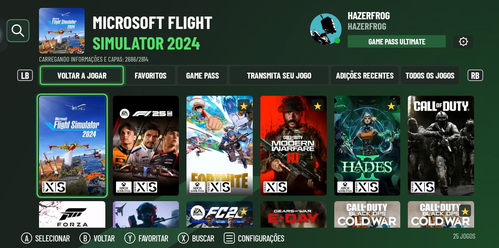

## Telas do aplicativo

A galeria reúne capturas reais de uso e telas de demonstração do app. O QR Code é ilustrativo.

<table>
  <tr>
    <td width="50%"> <strong>Abertura</strong> — Restauração da sessão com a identidade do aplicativo.</td>
    <td width="50%"> <strong>Configurações por categoria</strong> — Vídeo, imagem, aparência, rede, controles, áudio, diagnósticos e conta.</td>
  </tr>
</table>

## Conta e biblioteca

- Login Microsoft por QR Code e restauração da sessão salva.
- Perfil Xbox com avatar e identificação da assinatura, quando informados pelo serviço.
- **Voltar a jogar** com o histórico da conta no Xbox Cloud Gaming.
- Favoritos separados por conta e salvos no aparelho.
- **Game Pass**, **Transmita seu jogo**, **Adições recentes** e **Todos os jogos**.
- Catálogos oficiais com nomes, capas e identificação das edições.
- Selos de Game Pass e Xbox Series X|S conforme a inclusão e otimização informadas pelo catálogo.
- Pesquisa por nome, tolerando diferenças de acentos, pontuação e marcas.
- Navegação por controle ou toque e cache de imagens do catálogo.

<table>
  <tr>
    <td width="50%"> <strong>Conta Microsoft</strong> — Tela de entrada do aplicativo.</td>
    <td width="50%"> <strong>Login por QR Code</strong> — Autorização pelo celular.</td>
  </tr>
  <tr>
    <td width="50%">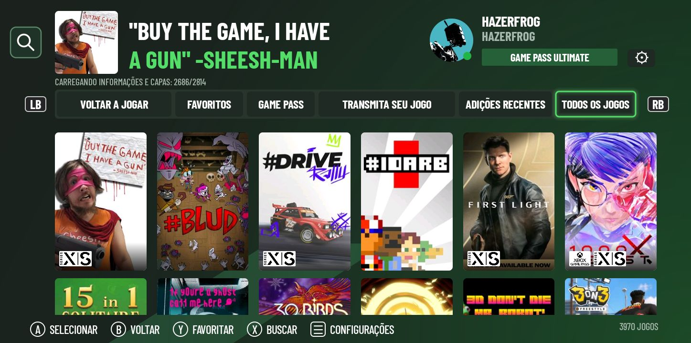 <strong>Biblioteca</strong> — Todos os jogos, com capas, selos e categorias.</td>
    <td width="50%">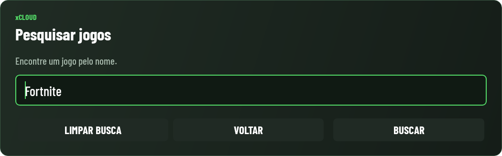 <strong>Pesquisa</strong> — Busca por nome usando o teclado.</td>
  </tr>
</table>

## Aparência e temas

- **Verde** como tema padrão, preservando a identidade original do app.
- Seis temas opcionais: **Azul Cibernético**, **Vermelho Vulcânico**, **Dourado Prestígio**, **Laranja Industrial**, **Roxo Galáxia** e **Prata Platina**.
- Seis dashboards opcionais, com composição e navegação próprias:
  - **Xbox 360 — Blades de 2005:** lâminas metálicas curvas, abas com títulos destacados, painel claro, pesquisa acima do perfil e lista de jogos.
  - **Xbox 360 — NXE de 2008:** navegação vertical, cartões em perspectiva, horizonte e piso reflexivo.
  - **Xbox 360 — Metro de 2011:** navegação por texto, coluna verde de atalhos e mosaico assimétrico de jogos.
  - **Xbox One:** blocos retangulares, destaque grande para o jogo selecionado, catálogo em mosaico e contorno branco de seleção.
  - **Xbox Series X|S:** arte panorâmica do jogo quando disponível, navegação por ícones vetoriais, relógio, jogo selecionado ampliado na faixa horizontal e atalhos ilustrados para a biblioteca.
  - **Xbox Original:** núcleo verde luminoso, categorias em menus e biblioteca em listas. A abre a categoria; B retorna ao menu.
- **Fundo dinâmico** opcional nesses seis temas: Automático, Ativado ou Desativado. O movimento fica no catálogo e pausa durante partidas. Automático preserva o fundo estático em aparelhos de pouca memória e interfaces acima de 1440p; economia de energia e animações desativadas no sistema também pausam o movimento.
- Seleção em **Configurações › Aparência e temas › Tema do aplicativo**, por controle ou toque.
- Aplicação imediata e escolha salva no aparelho, inclusive ao reabrir o app.
- Cores dos menus, catálogo, destaques e janelas; as artes e a imagem do jogo mantêm suas cores.

<table>
  <tr>
    <td width="50%">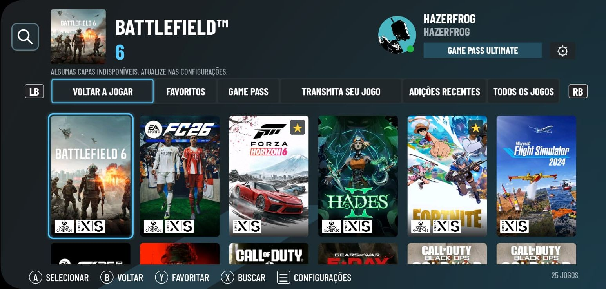 <strong>Azul Cibernético</strong></td>
    <td width="50%">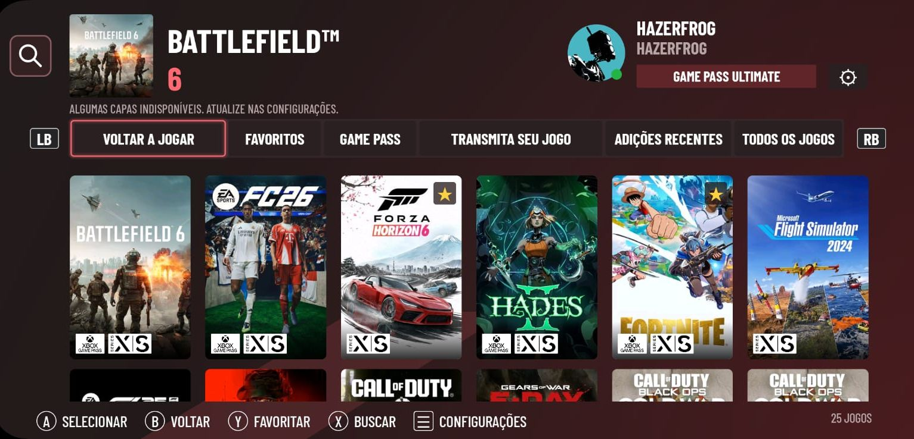 <strong>Vermelho Vulcânico</strong></td>
  </tr>
  <tr>
    <td width="50%">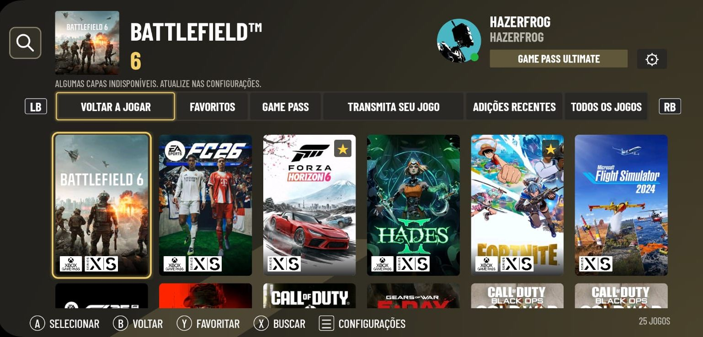 <strong>Dourado Prestígio</strong></td>
    <td width="50%">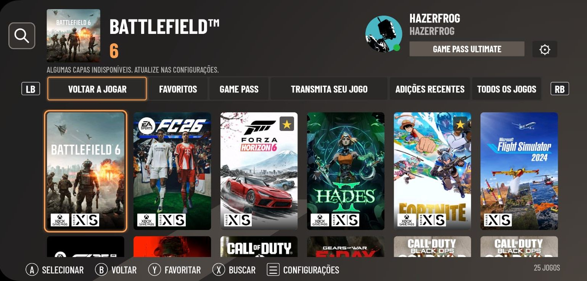 <strong>Laranja Industrial</strong></td>
  </tr>
  <tr>
    <td width="50%">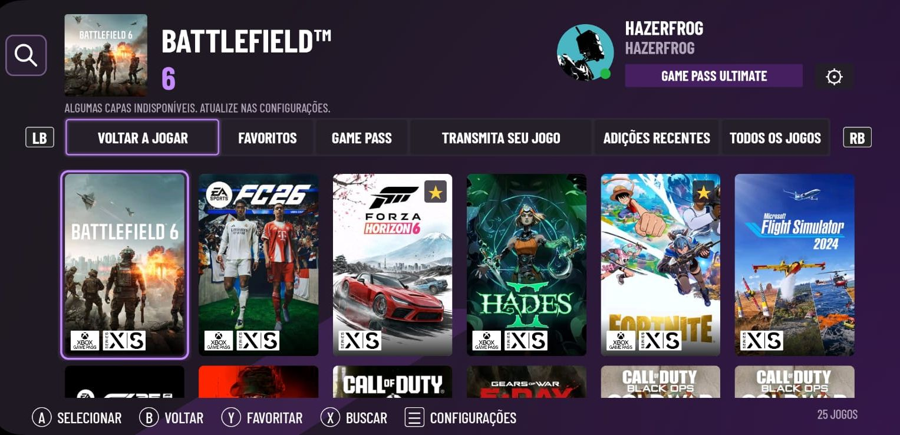 <strong>Roxo Galáxia</strong></td>
    <td width="50%">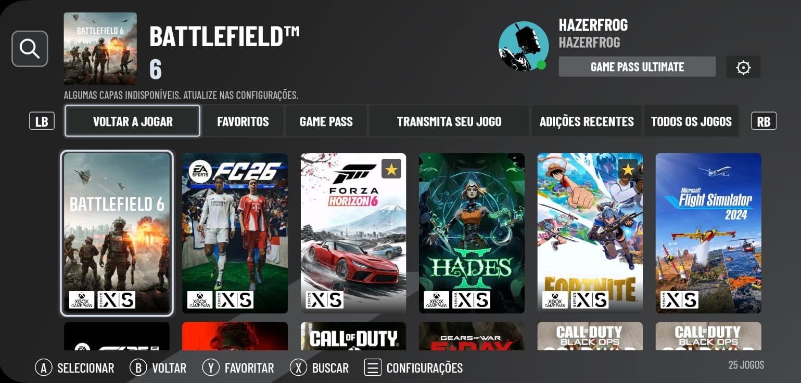 <strong>Prata Platina</strong></td>
  </tr>
  <tr>
    <td width="50%">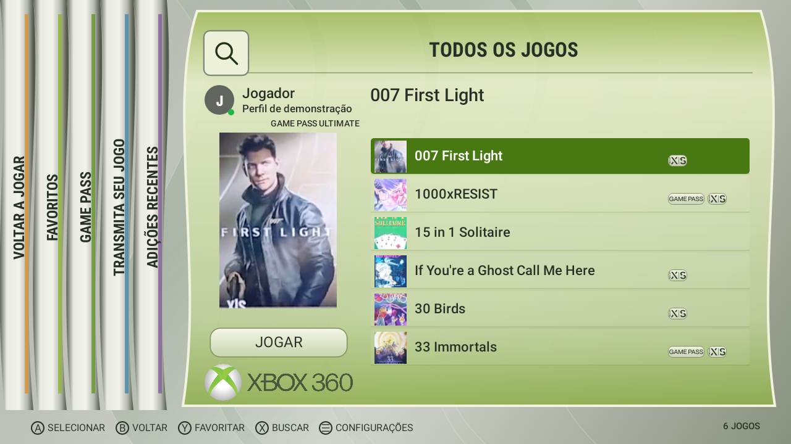 <strong>Xbox 360</strong></td>
    <td width="50%">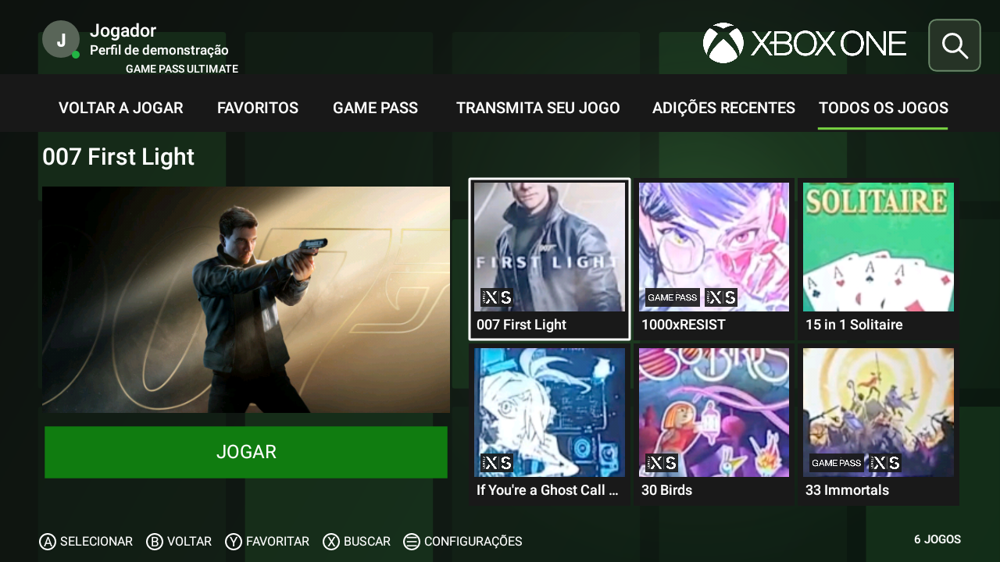 <strong>Xbox One</strong></td>
  </tr>
  <tr>
    <td width="50%">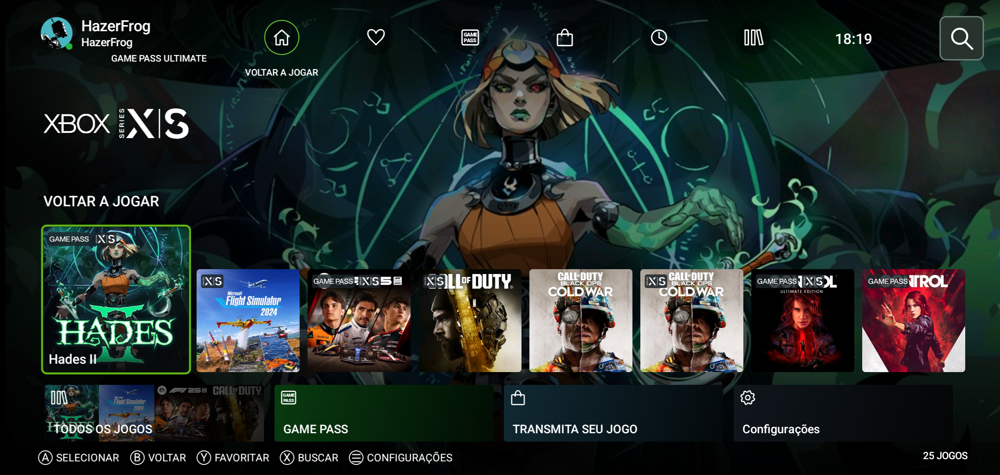 <strong>Xbox Series X|S</strong></td>
    <td width="50%">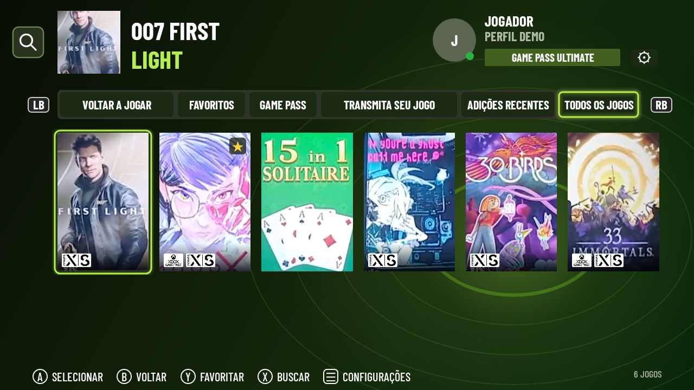 <strong>Xbox Original</strong></td>
  </tr>
  <tr>
    <td width="50%">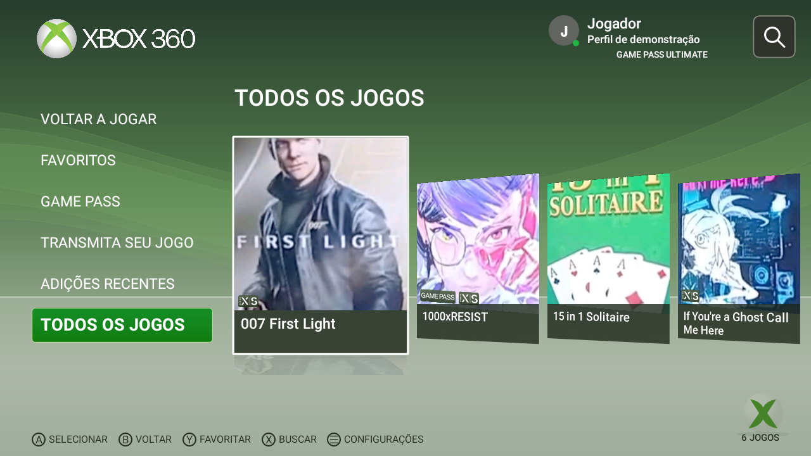 <strong>Xbox 360 — NXE (2008)</strong></td>
    <td width="50%">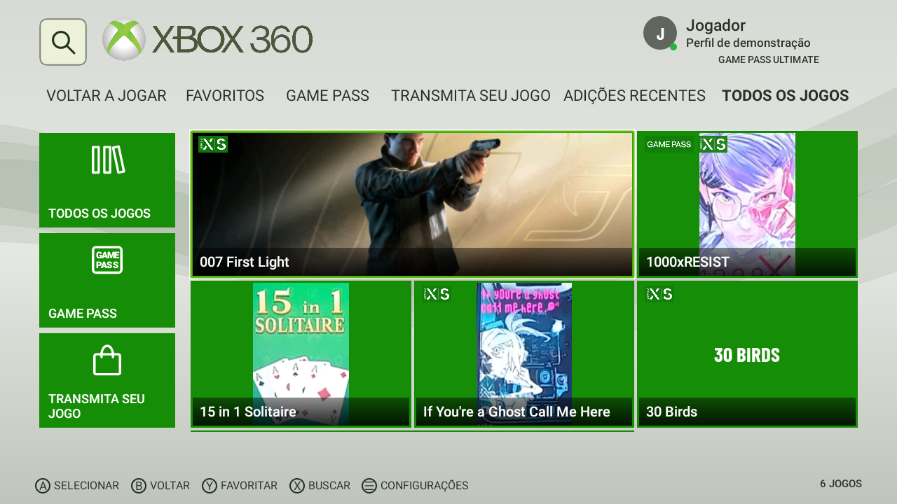 <strong>Xbox 360 — Metro (2011)</strong></td>
  </tr>
</table>

## Idiomas do aplicativo

- **Português (Brasil)** como padrão, com dez idiomas adicionais disponíveis sem baixar pacotes.
- Troca em **Configurações › Aparência e temas › Idioma do aplicativo**, na tela de login ou no menu da partida.
- Aplicação imediata e preferência salva no aparelho, sem reiniciar o app ou desconectar a partida.
- Nomes dos idiomas exibidos em sua forma nativa, para facilitar a volta ao idioma desejado.
- O idioma dos menus é independente do idioma solicitado aos jogos nas opções da sessão.

| País | Idioma |
|---|---|
| Brasil | Português |
| Estados Unidos | Inglês |
| Espanha | Espanhol |
| França | Francês |
| Alemanha | Alemão |
| Itália | Italiano |
| Japão | Japonês |
| Coreia do Sul | Coreano |
| China | Chinês simplificado |
| Rússia | Russo |
| Turquia | Turco |

<table>
  <tr>
    <td width="50%">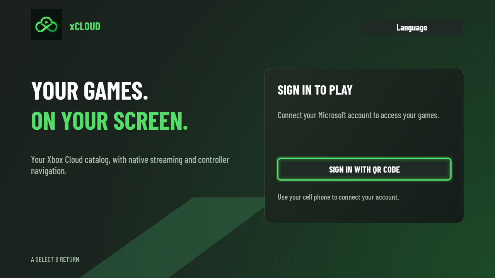 <strong>Inglês</strong> — Troca de idioma disponível antes do login.</td>
    <td width="50%">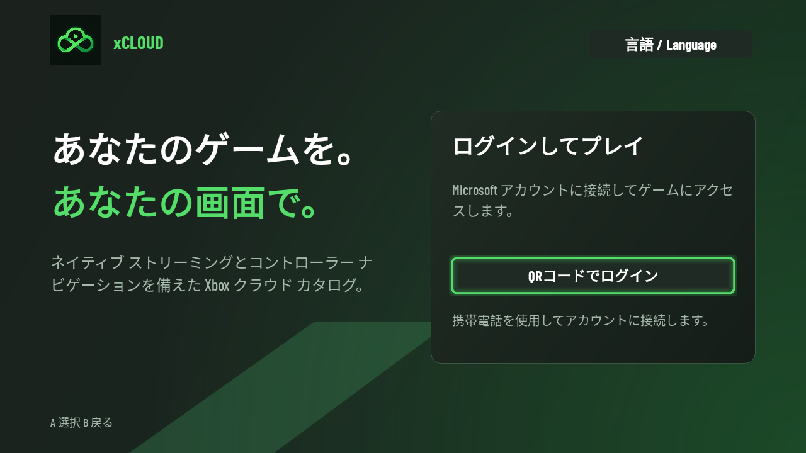 <strong>Japonês</strong> — Menus e textos no idioma escolhido.</td>
  </tr>
</table>

## Transmissão e fila

- Reprodução nativa por WebRTC/H.264, com preferência por decodificação de hardware.
- Perfis solicitados de **720p, 1080p, 1080p HQ e 1440p (2560×1440)**.
- Pedido de qualidade enviado ao Xbox pelo canal de controle. A resolução recebida depende da assinatura, do jogo e do serviço e pode ser menor que a escolhida.
- Modos **Menor atraso**, **Adaptativo** e **Compatibilidade — TVs mais fracas**.
- Opção **H.264 leve — Baseline (720p)**.
- **H.264 Main experimental**, oferecido quando o decoder de hardware declara suporte ao perfil e à resolução solicitada a 60 FPS. Baseline permanece disponível na negociação; o diagnóstico informa o perfil realmente recebido.
- **Fluidez da apresentação opcional** em Adaptativo, com fila de um quadro pendente e descarte de quadros substituídos. Pode acrescentar atraso; Menor atraso e Compatibilidade usam apresentação imediata.
- Fila com arte do jogo, estimativa do serviço, tempo aguardado e cancelamento. Os seis dashboards Xbox têm telas de espera próprias, acompanhando o visual do tema escolhido.
- Recuperação de vídeo por solicitação de quadro-chave, decoder e superfície de exibição.
- Menu da partida com ajustes e desconexão para retornar ao catálogo.

<table>
  <tr>
    <td width="50%">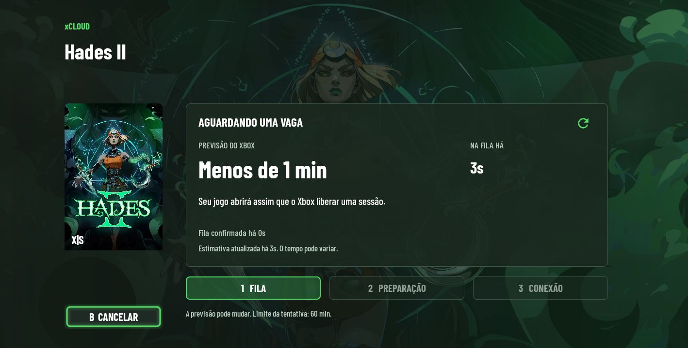 <strong>Fila</strong> — Hades II aguardando uma vaga, com estimativa do Xbox e etapas da conexão.</td>
    <td width="50%">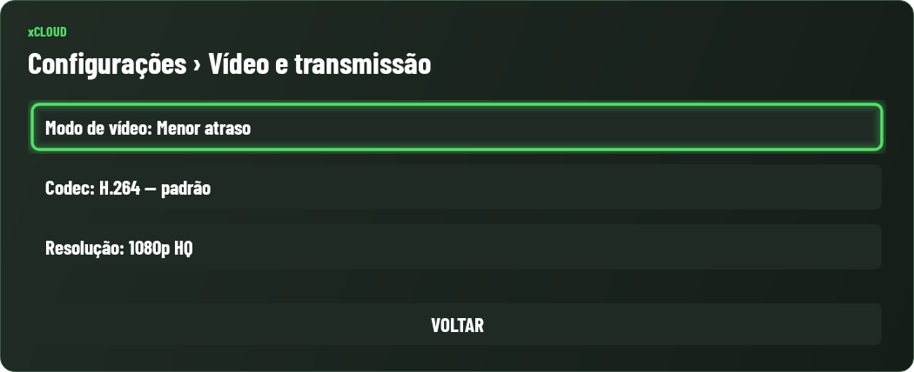 <strong>Vídeo e transmissão</strong> — Modo de vídeo, codec e resolução.</td>
  </tr>
  <tr>
    <td width="50%">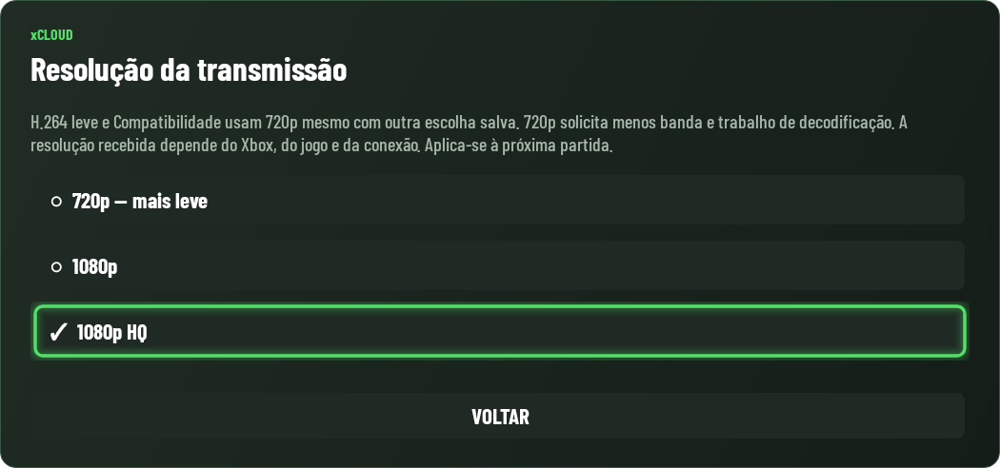 <strong>Resolução</strong> — Perfis 720p, 1080p, 1080p HQ e 1440p.</td>
    <td width="50%">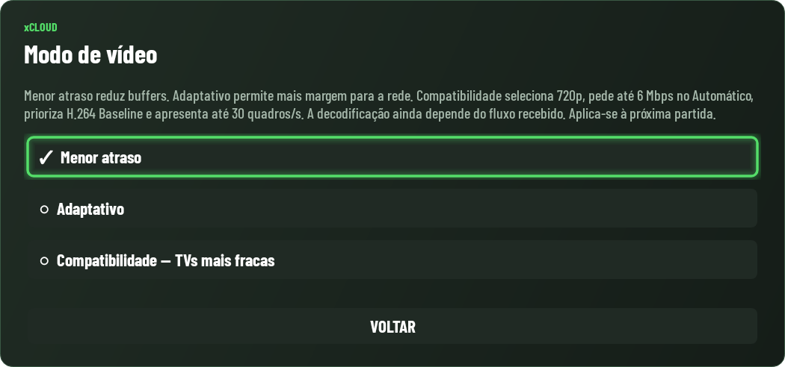 <strong>Modo de vídeo</strong> — Menor atraso, adaptativo e compatibilidade.</td>
  </tr>
  <tr>
    <td colspan="2" align="center"> <strong>Menu da partida</strong> — Ajustes, estatísticas e desconexão.</td>
  </tr>
</table>

<table>
  <tr>
    <td width="50%">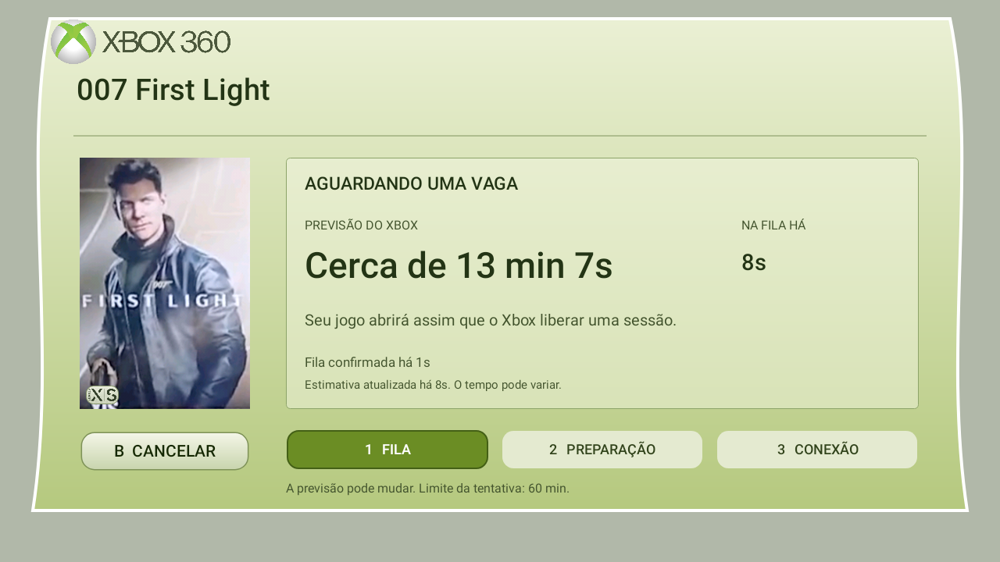 <strong>Fila — Xbox 360</strong></td>
    <td width="50%">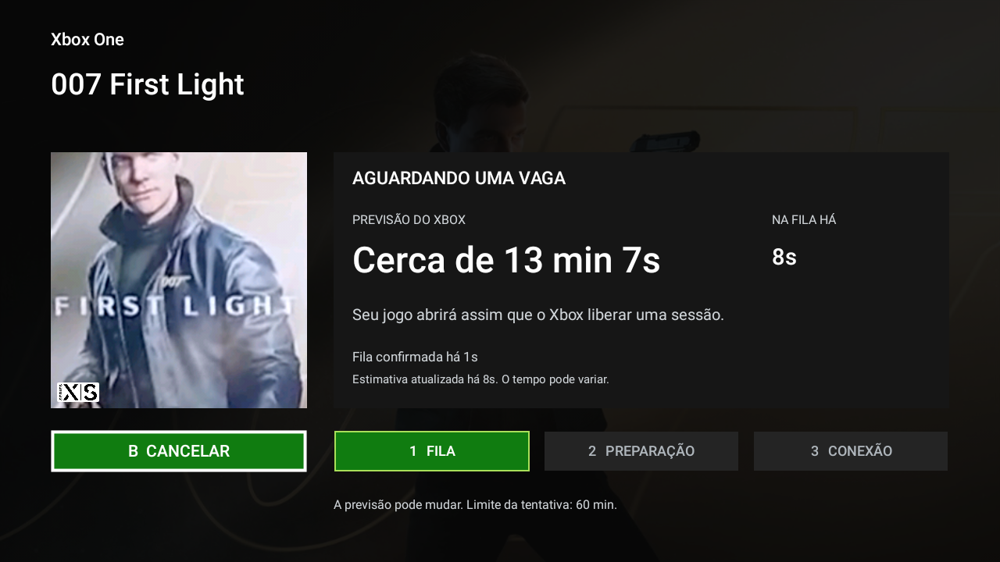 <strong>Fila — Xbox One</strong></td>
  </tr>
  <tr>
    <td width="50%">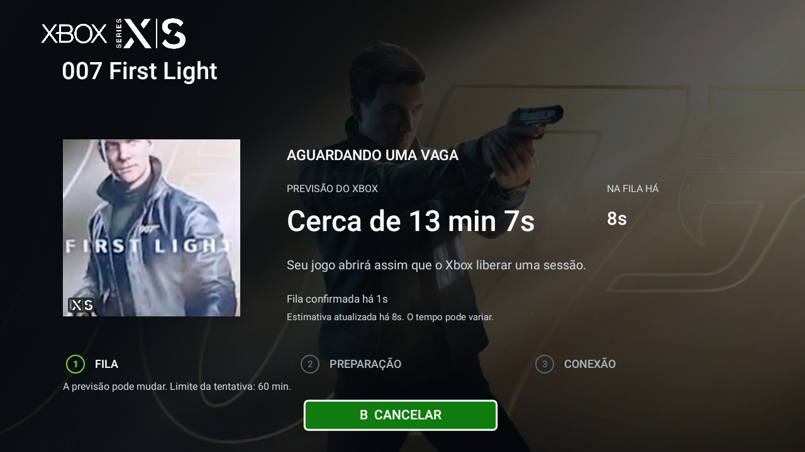 <strong>Fila — Xbox Series X|S</strong></td>
    <td width="50%">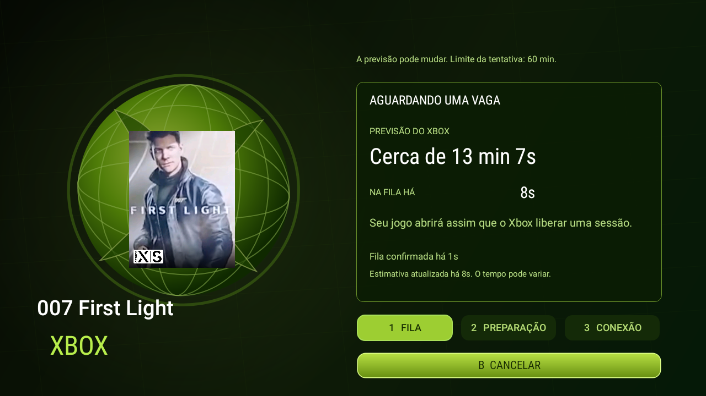 <strong>Fila — Xbox Original</strong></td>
  </tr>
  <tr>
    <td width="50%">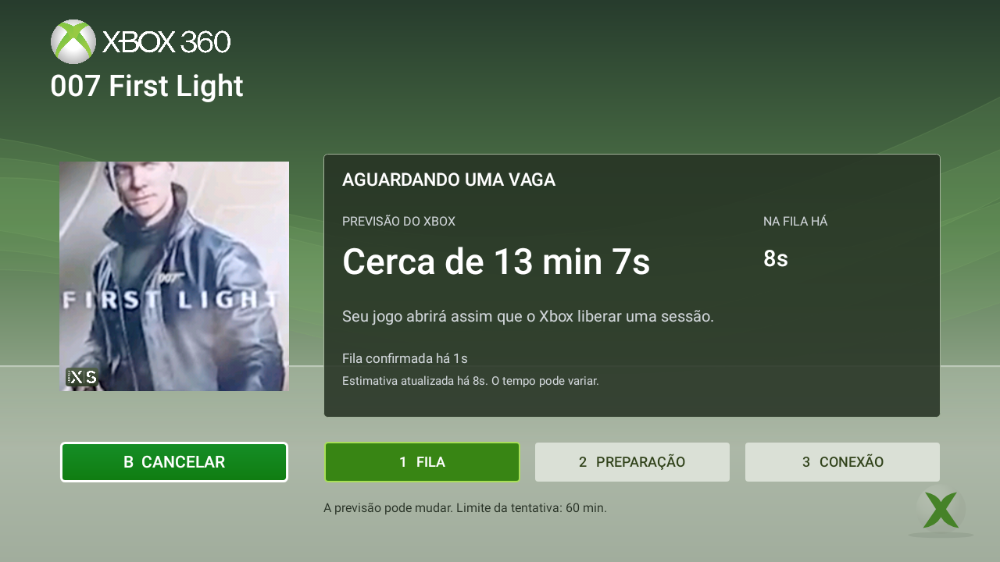 <strong>Fila — Xbox 360 NXE</strong></td>
    <td width="50%">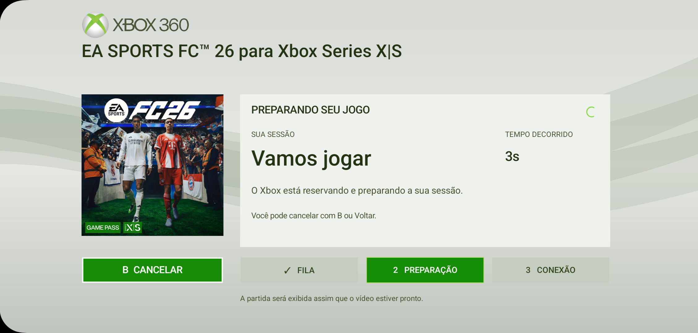 <strong>Fila — Xbox 360 Metro</strong></td>
  </tr>
</table>

## Imagem e tela

- Upscaling nativo do Android.
- Proporção original, 16:9, 18:9, 21:9, 16:10, 4:3, esticar e zoom.
- Troca de proporção durante o jogo pelo menu da partida, com aplicação imediata.
- Original preserva o quadro recebido; Esticar preenche a tela com deformação; Zoom preenche com corte, mantendo a proporção.
- Ajustes de nitidez, saturação, brilho e contraste durante a partida.
- **AMD FSR 1.0.2 experimental**, com ampliação EASU e nitidez RCAS, RCAS adaptativo ou USM por luminância; em resolução nativa, aplica somente o realce escolhido.
- Saída do FSR em **Automático, 1440p ou 4K experimental**, com proteção para retorno à escala padrão.
- **SGSR 1 experimental** como alternativa de ampliação e realce numa passagem.
- **Reconstrução adaptativa xCloud experimental**, com níveis Automático, Leve, Equilibrado e Qualidade, intensidade ajustável e realce na resolução atual. O caminho espacial próprio usa uma passagem; efeitos adicionais podem acrescentar processamento.
- Comparação da reconstrução com imagem **original, tratada ou dividida no mesmo quadro**, sem mudar os controles ou o enquadramento. O automático aumenta o nível após cadência estável e reduz a carga quando necessário.
- Tratamento opcional com **RCAS adaptativo ou USM na luminância**, limite de halos e proteção contra ruído.
- **Debanding com dithering**, limpeza seletiva de compressão, reconstrução de cor nas bordas e antialiasing ajustáveis.
- **Estabilização temporal** com busca local de movimento, descarte de histórico em mudanças de geometria e rejeição de mudanças de cena.
- **Reconstrução neural experimental** na luminância, com buffers half-float verificados e fonte de até 1080p; disponibilidade efetiva mostrada no diagnóstico.
- Configuração central em **Imagem e tela › Upscaling e tratamento**: escolha do método, ajustes correspondentes e filtros adicionais compartilhados. Perfis **Leve** e **Natural** ajustam a nitidez do método escolhido; a restauração da imagem original fica na mesma tela.
- Proteção progressiva reduz efeitos e saída quando os desenhos ficam abaixo da cadência recebida, preservando as preferências salvas e registrando os cortes da partida.
- Preferência por uma taxa de atualização compatível com a apresentação do vídeo.

<table>
  <tr>
    <td width="50%">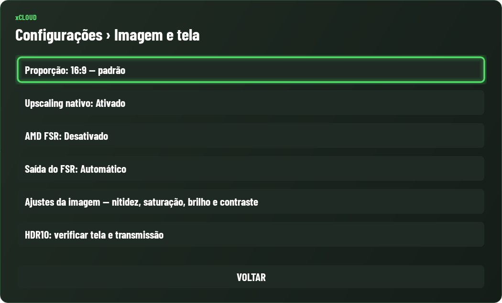 <strong>Imagem e tela</strong> — Opções de proporção, escala e FSR.</td>
    <td width="50%"> <strong>Ajustes básicos</strong> — Nitidez e saturação do vídeo.</td>
  </tr>
  <tr>
    <td width="50%">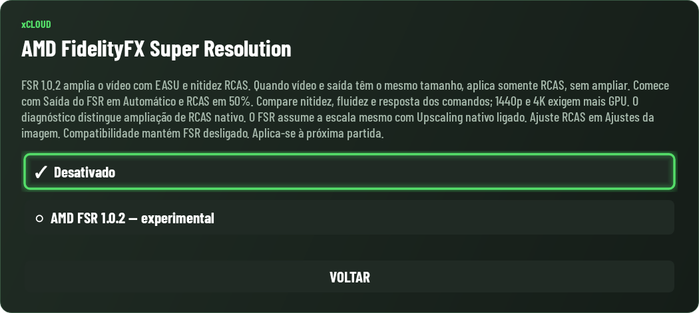 <strong>AMD FSR</strong> — Explicação e ativação do filtro experimental.</td>
    <td width="50%">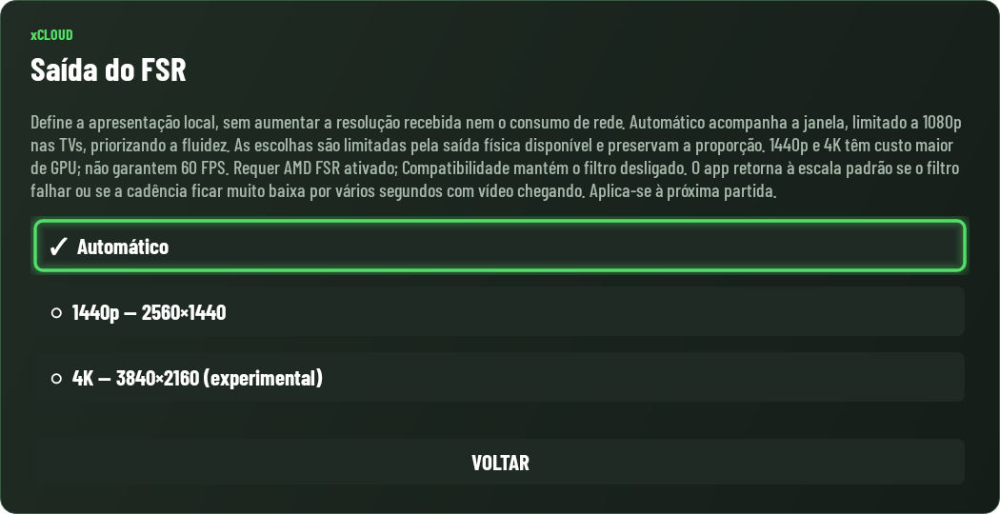 <strong>Saída do FSR</strong> — Automático, 1440p e 4K experimental.</td>
  </tr>
  <tr>
    <td width="50%">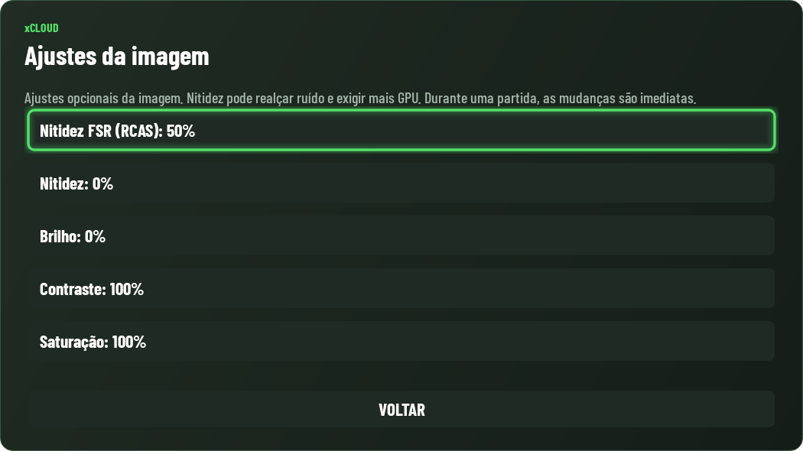 <strong>Ajustes da imagem</strong> — RCAS, nitidez, brilho, contraste e saturação.</td>
    <td width="50%">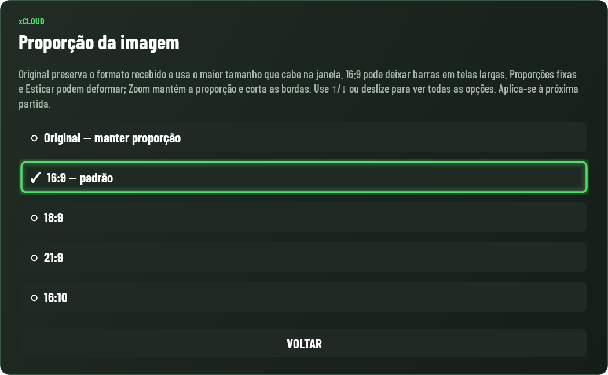 <strong>Proporção</strong> — Formato original, proporções fixas, esticar e zoom.</td>
  </tr>
</table>

## Controles e periféricos

- Controles USB, Bluetooth e dongles reconhecidos pelo Android.
- Perfis por controle com zonas mortas, sensibilidade, curvas dos analógicos, inversão, gatilhos e remapeamento.
- Coop local com até quatro controles, quando aceito pelo jogo e pela sessão.
- Mouse e teclado nativos nos jogos compatíveis ou emulação de controle.
- Giroscópio opcional para mira, com sensibilidade e ativação por LT, LB ou contínua.
- Opção experimental de giroscópio junto ao toque nativo Xbox.
- Vibração nos dispositivos compatíveis, teste USB/XInput opcional e vibração do celular no toque.

<table>
  <tr>
    <td width="50%"> <strong>Controles</strong> — Preferências de coop local, vibração e toque.</td>
    <td width="50%">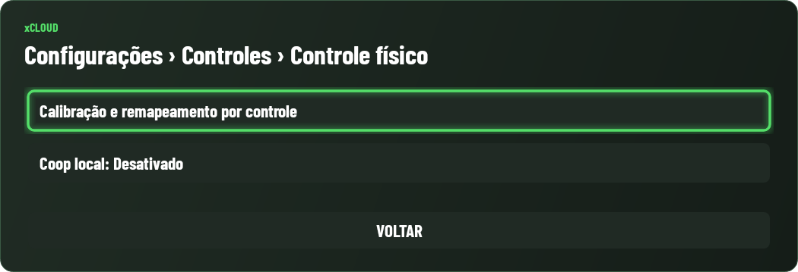 <strong>Controle físico</strong> — Acesso à calibração e ao remapeamento.</td>
  </tr>
  <tr>
    <td width="50%">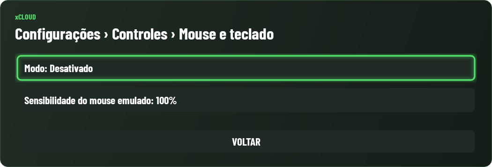 <strong>Mouse e teclado</strong> — Entrada nativa ou emulação de controle.</td>
    <td width="50%">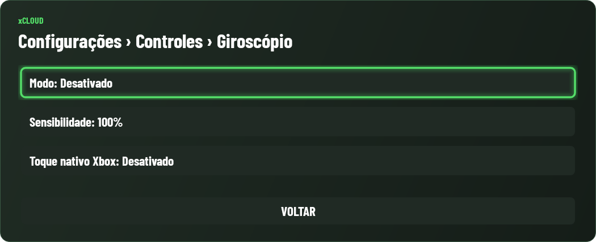 <strong>Giroscópio</strong> — Modo de mira e sensibilidade do movimento.</td>
  </tr>
  <tr>
    <td width="50%">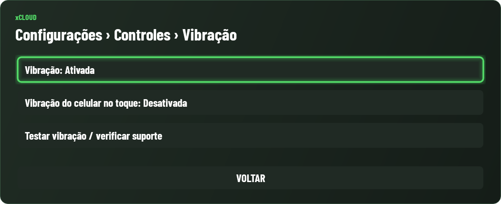 <strong>Vibração</strong> — Opções para o controle e para o celular.</td>
    <td width="50%">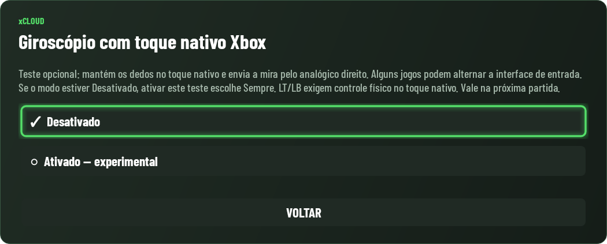 <strong>Giroscópio com toque nativo</strong> — Ativação experimental quando há sensor.</td>
  </tr>
</table>

## Touch nativo

- Toque nativo Xbox nos jogos que anunciam suporte no catálogo, incluindo **Fortnite**.
- Os toques são enviados ao jogo, que apresenta seus próprios botões e gestos, sem o HUD virtual do aplicativo.
- No celular, **Automático** prioriza o toque nativo quando disponível; a opção **Toque nativo Xbox — experimental** permite selecioná-lo manualmente nos títulos compatíveis.
- Mapeamento dos toques conforme a área do vídeo, incluindo os modos Original, Esticar e Zoom.
- Giroscópio opcional junto ao toque nativo, em aparelhos com sensor e jogos que aceitem essa combinação de entradas.

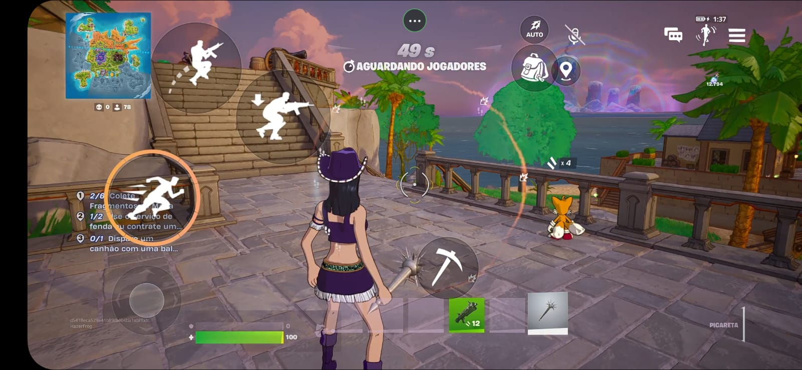

O suporte depende do jogo e da sessão. Ter um layout de controle virtual na nuvem não significa ter toque nativo direto. Jogos com vídeo 16:9 podem apresentar barras laterais em celulares largos.

## Controles de toque

- Controle Xbox virtual e layouts para tiro, corrida, futebol e ação.
- HUDs para Call of Duty, Forza, EA SPORTS FC/FIFA e Hades.
- Movimento com múltiplos dedos, câmera por arrasto e pedais nos jogos de corrida.
- Alternância manual entre ataque e defesa no futebol, com esquemas Clássico e Alternativo.
- Aplicação do esquema de futebol com restauração dos comandos, mantendo posições e tamanhos personalizados.
- No CoD, arrasto no botão de mira, opção de mirar ao atirar e corrida ao estender o analógico na direção de Correr.
- Editor de posição, tamanho, opacidade, comandos combinados e gestos por jogo.

<table>
  <tr>
    <td width="50%">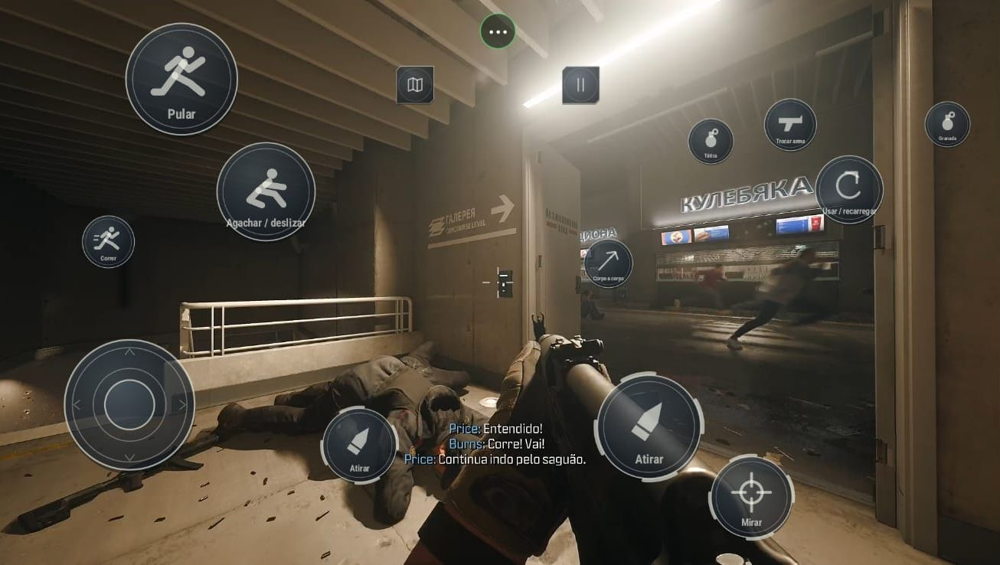 <strong>Call of Duty</strong> — Gameplay com analógico virtual, mira, disparo e ações na tela.</td>
    <td width="50%">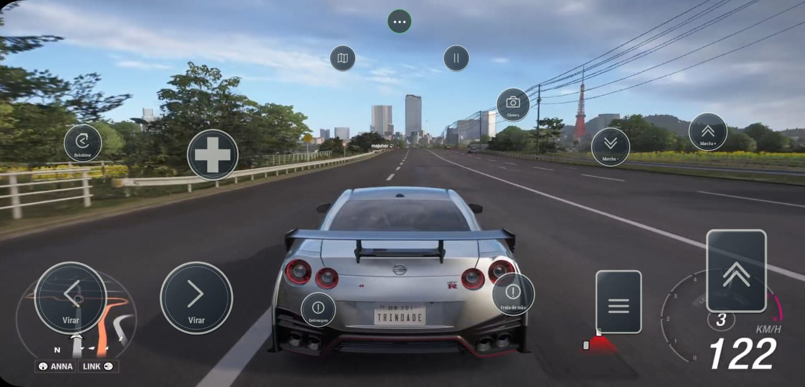 <strong>Corrida</strong> — Direção, acelerador, freio e marchas.</td>
  </tr>
  <tr>
    <td colspan="2" align="center">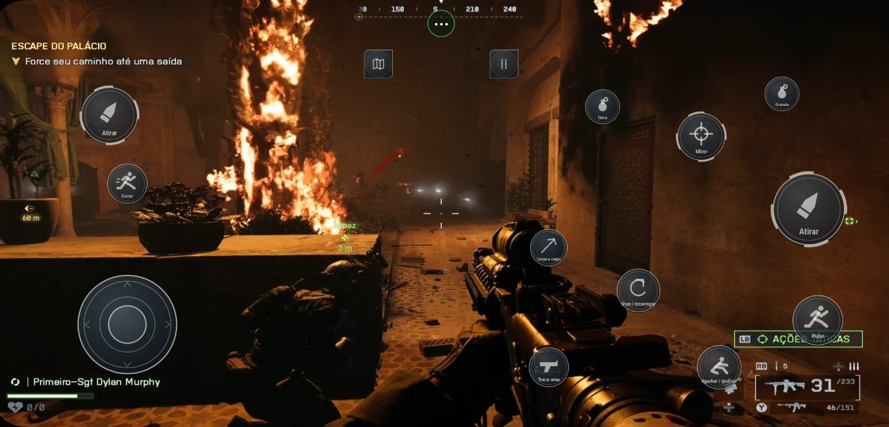 <strong>Battlefield 6</strong> — Gameplay com movimento, mira, disparo e ações do HUD de tiro.</td>
  </tr>
  <tr>
    <td width="50%">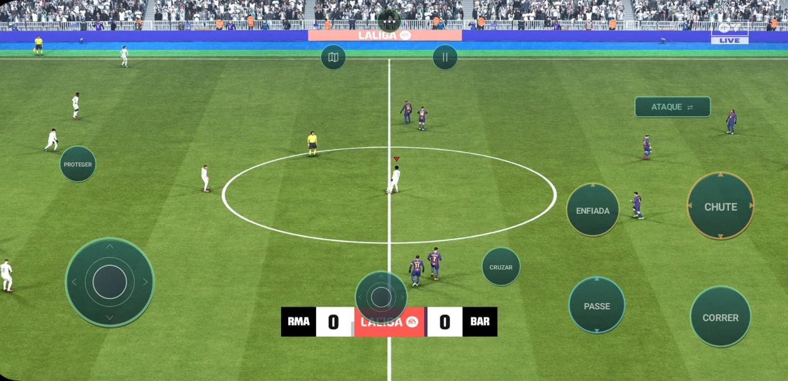 <strong>Futebol em ataque</strong> — Passes, chute, enfiada e corrida.</td>
    <td width="50%">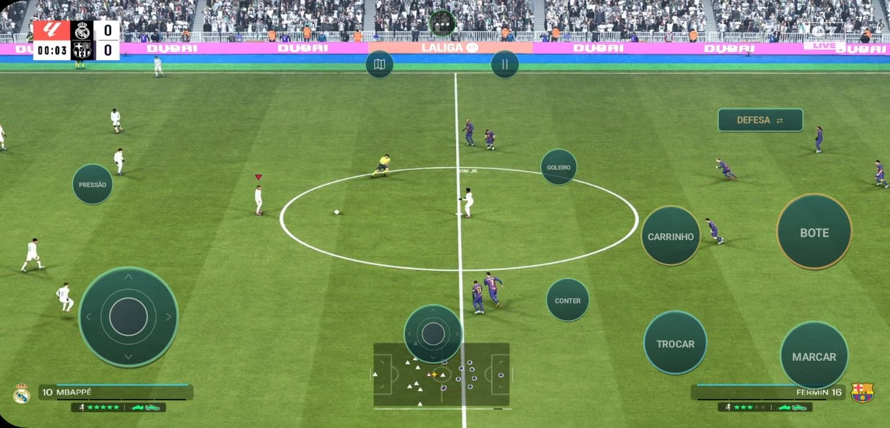 <strong>Futebol em defesa</strong> — Marcação, bote, carrinho e troca de jogador.</td>
  </tr>
  <tr>
    <td width="50%">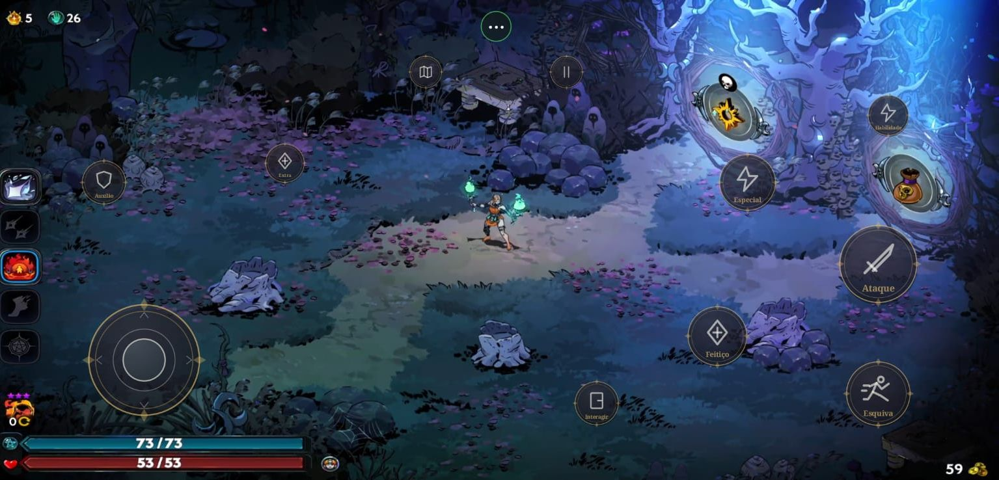 <strong>Hades II</strong> — Ataque, especial, feitiço e esquiva.</td>
    <td width="50%"> <strong>Editor</strong> — Posição, tamanho, comandos combinados e gestos.</td>
  </tr>
  <tr>
    <td width="50%"> <strong>Ajustes do HUD</strong> — Layout, opacidade e sensibilidade por jogo.</td>
    <td width="50%">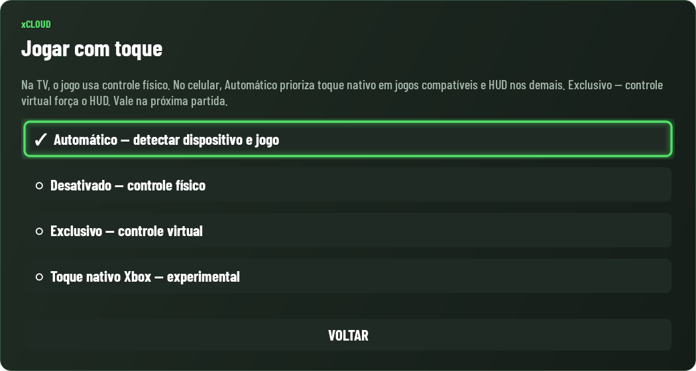 <strong>Modo de toque</strong> — Detecção automática, HUD virtual ou toque nativo.</td>
  </tr>
  <tr>
    <td width="50%">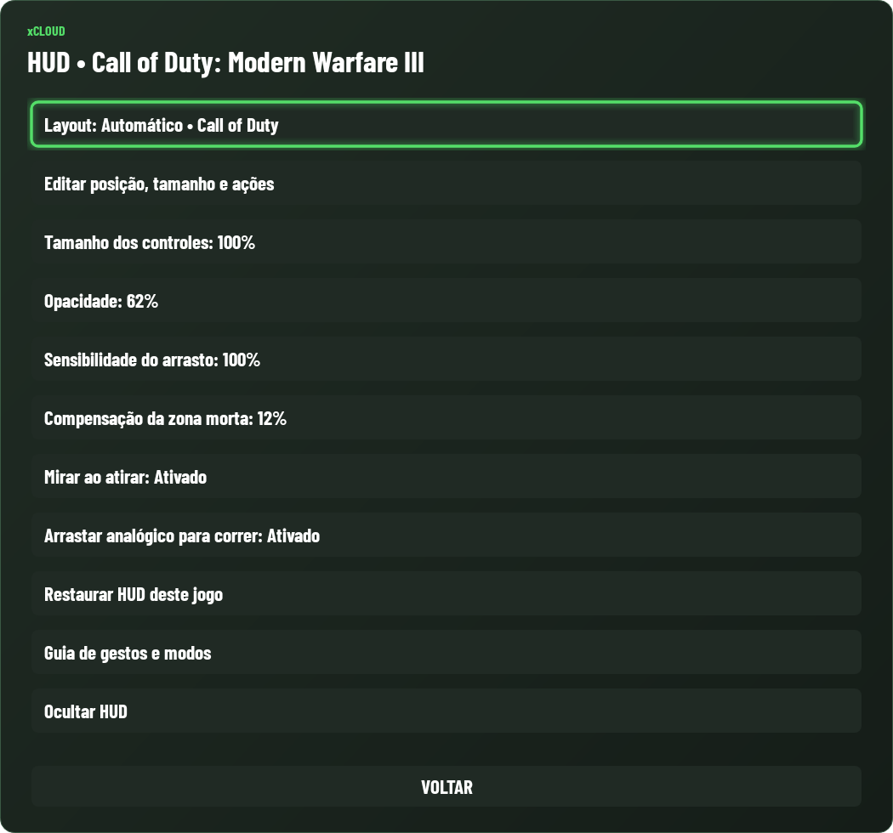 <strong>CoD</strong> — mirar ao atirar e corrida por gesto, configuráveis por jogo.</td>
    <td width="50%">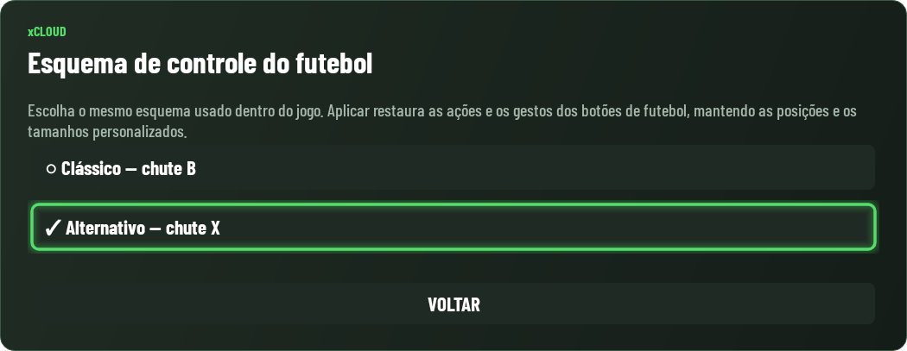 <strong>Esquema de futebol</strong> — aplicar Clássico ou Alternativo e restaurar os comandos sem mover os botões.</td>
  </tr>
</table>

As posições, tamanhos, ações e gestos podem ser ajustados por jogo. No futebol, a alternância entre ataque e defesa é manual.

## Áudio e microfone

- Reprodução estéreo com gerenciamento de foco de áudio do Android.
- Ganho ajustável até 300%, com redução adaptativa de picos.
- Microfone opcional com permissão ao ativar e início em mudo.
- Controle de mudo durante a sessão.

<table>
  <tr>
    <td width="50%">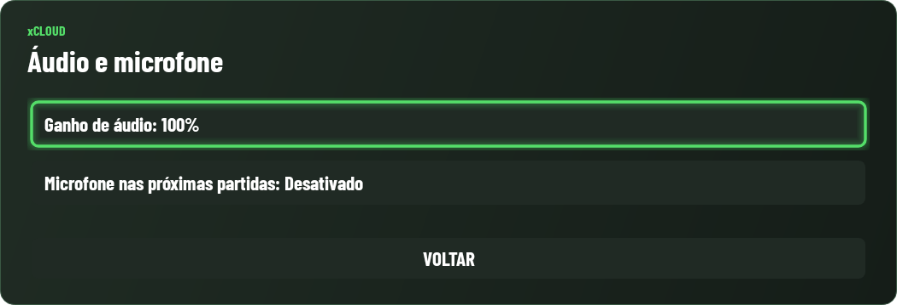 <strong>Áudio e microfone</strong> — Ganho local e disponibilidade do microfone.</td>
    <td width="50%">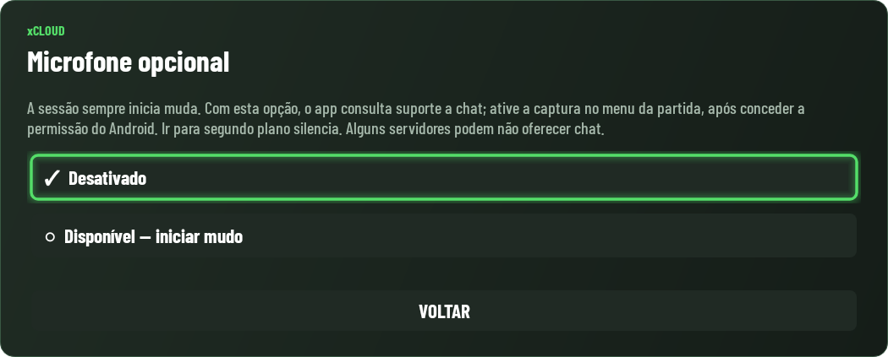 <strong>Microfone opcional</strong> — Habilitação para as próximas partidas, iniciando em mudo.</td>
  </tr>
  <tr>
    <td colspan="2" align="center">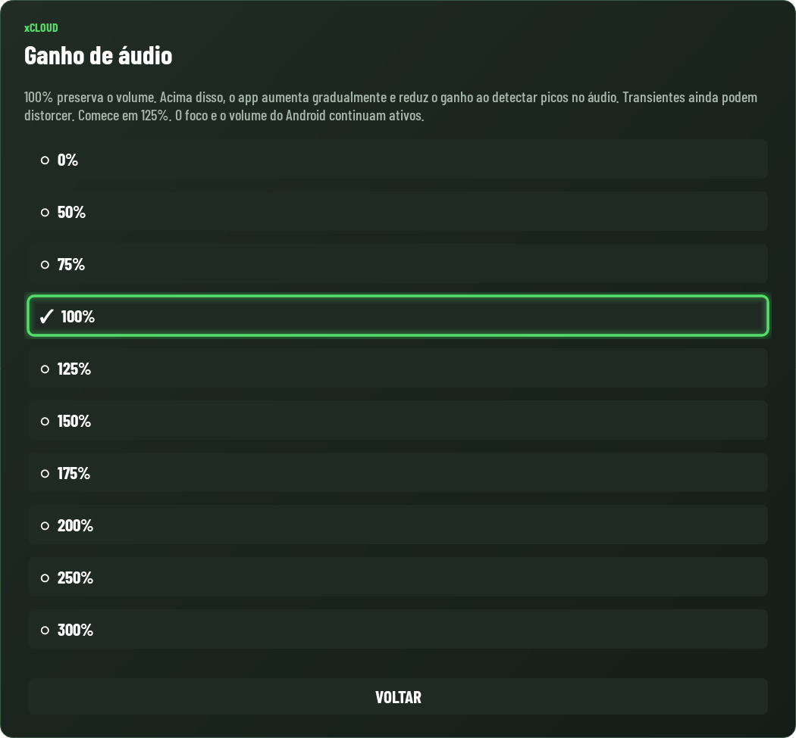 <strong>Ganho de áudio</strong> — Seleção do volume local até 300%.</td>
  </tr>
</table>

## Rede e preferências

- Configurações organizadas por categoria.
- Teto de bitrate solicitado em Automático ou entre 1 e 50 Mbps, salvo por jogo.
- Escolha entre as regiões oferecidas à conta.
- Idioma solicitado à sessão configurável por jogo.
- Modo automático IPv4/IPv6 e opções de preferência por uma família de rede.

<table>
  <tr>
    <td width="50%"> <strong>Rede e sessão</strong> — Família de rede e opções por jogo.</td>
    <td width="50%"> <strong>IPv4 e IPv6</strong> — Automático e preferências por família de rede.</td>
  </tr>
  <tr>
    <td width="50%"> <strong>Opções por jogo</strong> — Bitrate, região e idioma da sessão.</td>
    <td width="50%"> <strong>Teto de bitrate</strong> — Automático ou limite manual solicitado.</td>
  </tr>
  <tr>
    <td width="50%"> <strong>Região do servidor</strong> — Exemplo com uma região oferecida à conta de demonstração.</td>
    <td width="50%"> <strong>Idioma da sessão</strong> — Idioma solicitado ao jogo, separado da interface.</td>
  </tr>
</table>

## Estatísticas e diagnósticos

- Resolução e codec recebidos, FPS decodificados e bitrate.
- RTT, jitter, perda de pacotes, buffer, descartes e tempo de decodificação.
- Estatísticas durante a partida com ativação manual.
- Resumo local pós-partida com médias, picos, pausas observadas e recuperações.
- Motivo do encerramento em destaque, quando identificado.
- Diagnóstico do HUD com idade dos toques, opções do layout e último controle identificado.
- Último diagnóstico salvo no aparelho e exibição automática opcional.

<table>
  <tr>
    <td width="50%"> <strong>Resumo pós-partida</strong> — Métricas de rede e vídeo com dados de demonstração.</td>
    <td width="50%"> <strong>Preferências do diagnóstico</strong> — Abertura automática e consulta ao último resumo.</td>
  </tr>
</table>

## Tela inicial da TV

- Atalhos instaláveis para abrir jogos diretamente no xCLOUD.
- Canal de favoritos nos launchers compatíveis.
- Solicitação de atalhos fixados quando oferecida pelo sistema.
- Restauração da sessão e entrada na fila ao abrir um atalho.

<table>
  <tr>
    <td width="50%"> <strong>Biblioteca e conta</strong> — Acesso ao menu Atalhos dos favoritos.</td>
    <td width="50%"> <strong>Entrada por atalho</strong> — Fortnite durante a preparação da sessão pelo atalho.</td>
  </tr>
</table>

## Compatibilidade

- Android 7.0 ou superior, incluindo Android TV, Google TV e celulares compatíveis.
- Interface adaptada para navegação pelo controle e por toque.
- Recursos experimentais e suporte a periféricos dependem do aparelho, do driver, do jogo e do serviço.
- A disponibilidade dos jogos depende da conta, região, assinatura ou licença exigida pelo Xbox Cloud Gaming.

<table>
  <tr>
    <td width="50%"> <strong>Modo de compatibilidade</strong> — Opção de vídeo para dispositivos mais modestos.</td>
    <td width="50%"> <strong>H.264 leve</strong> — Perfil Baseline com solicitação de 720p.</td>
  </tr>
</table>

## Licença

O código original do projeto está sob a [licença MIT](LICENSE). Bibliotecas, fontes e componentes de terceiros mantêm suas próprias licenças; consulte os [avisos de terceiros](THIRD_PARTY_NOTICES.md). A licença do código não concede direitos sobre nomes, marcas ou artes de jogos de terceiros.

---

Cliente independente, sem afiliação com Microsoft ou Xbox. Nomes, marcas e artes dos jogos pertencem aos respectivos titulares.
