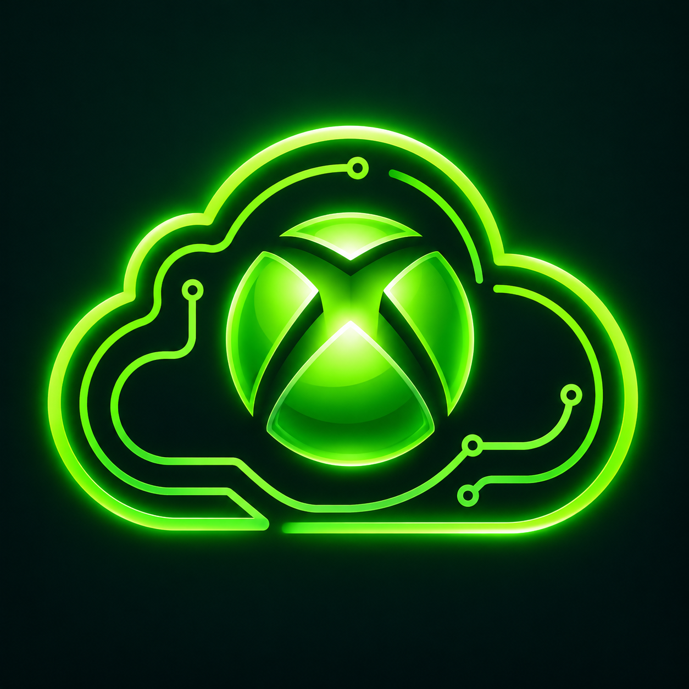
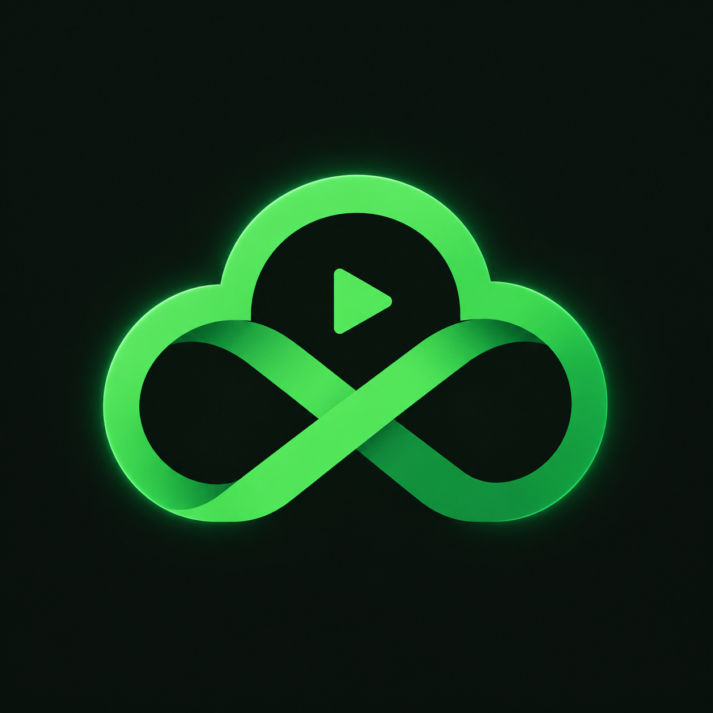
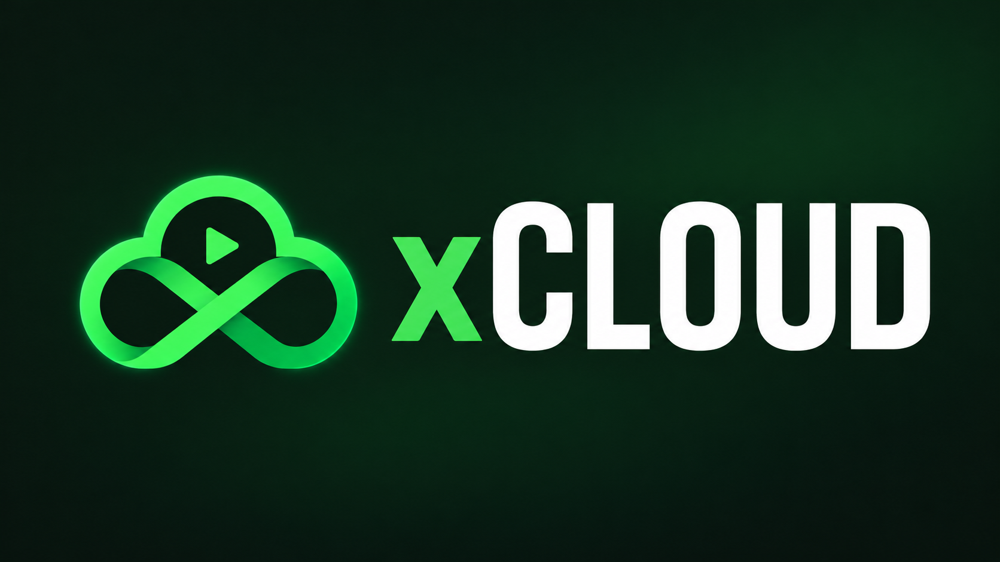

# Propostas de logo xCLOUD

**A — referência adaptada.** Mantém a nuvem de circuitos e a esfera verde da imagem enviada. O símbolo foi preparado sem o texto para o ícone pequeno. É uma adaptação gerada da referência, não o arquivo original enviado. Fica preservada para comparação.

**B — proposta própria, escolhida pelo usuário e aplicada no APK.** Nuvem simples, caminhos que formam um “x” e um símbolo de transmissão. Usa o verde e o carvão do aplicativo, com menos detalhes para leitura em tamanhos pequenos. Está no ícone Android, login e banner da TV.

**Banner para Android TV com a proposta B:**

