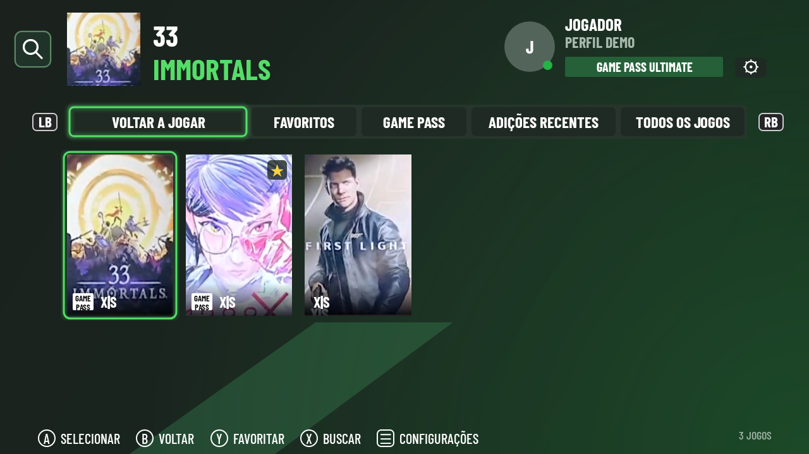

# Histórico da conta e pacotes de atalhos — 0.29

## Voltar a jogar

A primeira aba consulta `GET /v2/titles/mru?mr=25` na região da sessão Xbox Cloud, com o token GSSV já obtido pelo login. Essa rota também é usada por [XStreaming, `getRecentTitles`](https://github.com/Geocld/XStreaming/blob/06ef1c7ee01d09cf9bb2a97fc4895da85e8488a8/src/xCloud/index.ts#L1061). A implementação não usa a galeria pública de adições recentes nem o histórico geral de conquistas do Xbox.

O resultado é cruzado com o catálogo cloud atual, preservando a ordem do serviço. A correspondência prefere o ID de lançamento; IDs de produto ou título Xbox só são aceitos quando identificam uma única entrada. Duplicatas, títulos indisponíveis e edições ambíguas são descartados. O histórico nunca concede acesso a jogos.

Os últimos 25 IDs resolvidos são armazenados nas preferências privadas da conta. Uma resposta válida vazia limpa o histórico salvo; falhas HTTP ou respostas sem `results` não o apagam. A interface distingue carregamento, histórico salvo sem atualização e lista vazia confirmada. Os registros locais antigos são preservados, mas não preenchem essa aba. Favoritos e registros seguem a migração por XUID verificado.

A consulta ocorre ao montar ou restaurar o catálogo e ao retornar ao aplicativo com o menu aberto. Ela tem limite de seis segundos, é cancelada ao iniciar uma partida e não é iniciada na entrada direta por atalho. Respostas de views descartadas não atualizam outra conta. A disponibilidade e a atualização imediata dos registros dependem do serviço Xbox.

## Correção dos APKs de atalhos

Foi reproduzido um defeito na estrutura ZIP: o campo Android `0xd935` era preenchido somente com zeros de padding. Esse campo exige dois bytes com o alinhamento declarado antes do padding. Conforme os offsets do pacote, o gerador produzia um campo curto ou alinhamento zero. Um teste de regressão falhou com `expected: 4, was: 0` antes da correção. O defeito depende do layout do arquivo; os caracteres `®` dos nomes do Call of Duty passaram pela leitura do manifest e não foram removidos.

O gerador agora escreve o alinhamento 4 e calcula o padding incluindo todo o cabeçalho. Uma data ZIP estável, afastada do início do formato DOS, evita campos de data implícitos na fronteira de 1980 em diferentes fusos horários. Após assinar, verifica o esquema APK v2 e o certificado esperado. O aplicativo também solicita ao PackageManager do aparelho a leitura do pacote e confere a Activity exportada do atalho antes de entregá-lo ao instalador.

Cada criação usa arquivos de modelo e saída exclusivos: uma tentativa cancelada não sobrescreve o pacote que outro instalador ainda pode estar lendo. O nome do pacote e a chave Android Keystore `xcloud-game-shortcuts-v1` permanecem estáveis. A assinatura fixa de atualização do aplicativo principal também é preservada.

## Validação e limites

Os testes geram APKs assinados com nomes de Call of Duty, verificam o manifest com `aapt`, alinhamento com `zipalign`, assinatura v2 e o campo de alinhamento em diferentes layouts e fusos. Histórico: consulta autenticada em servidor de teste, ordem remota, resolução de IDs, respostas inválidas, limite de itens, cache por conta, migração e estados da interface.

Essas verificações não substituem uma nova instalação dos atalhos nas TVs afetadas nem uma consulta autenticada ao histórico real da conta. Não foram instalados pacotes nos aparelhos físicos neste ambiente. Os exemplos de documentação usam apenas dados de demonstração.
