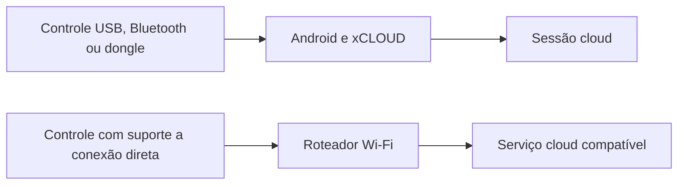

# Abertura do catálogo e análise de recursos — 0.30

> Atualização de 5/11/2026: a [investigação com acesso à internet](xbox-nano-gamesir-frame-generation-research.md) confirmou oficialmente a prévia Wi-Fi cloud connect do Xbox Nano nos EUA e verificou os limites para GameSir e interpolação. A análise abaixo registra o estado anterior, em que o Xbox Wire estava bloqueado neste ambiente.

## Abertura em Voltar a jogar

Ao construir o catálogo, a aba inicial é **Voltar a jogar**, com o último histórico confirmado da conta enquanto ocorre a atualização. Um histórico vazio ou indisponível continua exibindo o estado correspondente, sem trocar automaticamente para outra categoria. LB/RB permitem acessar as demais abas. O retorno para uma view de catálogo já existente preserva a categoria que estava selecionada.

A lupa e o atalho X pesquisam em **Todos os jogos**, inclusive quando a busca é iniciada na aba de histórico. Entradas diretas por atalho de jogo continuam seguindo para a fila.

Os 262 testes passaram, incluindo abertura com histórico salvo, ordem do serviço, estados de falha/lista vazia, navegação circular, pesquisa fora do histórico e retorno de um atalho. APK e lint passaram com a assinatura fixa preservada.

## Geração de quadros em aparelhos modestos

Interpolação real estima movimento entre imagens para criar quadros intermediários. Pode melhorar a apresentação de uma fonte estável de 30 FPS em uma tela de 60 Hz; não aumenta a frequência com que o jogo remoto processa os comandos. Também não recupera por si só um fluxo sem quadros novos durante um congelamento prolongado.

O [XStreaming](https://github.com/Geocld/XStreaming#about-frame-generation) integra um caminho baseado em [LSFG-Android](https://github.com/FrankBarretta/LSFG-Android). O projeto LSFG-Android documenta execução funcional em GPUs Adreno 7xx ou mais recentes, pipeline Vulkan e uso de shaders extraídos de uma cópia legítima de `Lossless.dll`, fornecida pelo próprio usuário. Isso não estabelece suporte ou desempenho adequado em qualquer GPU Mali ou TV Android.

O aplicativo externo LSFG-Android utiliza MediaProjection e overlay; a latência adicional descrita em seu README pertence a essa arquitetura de captura. Uma integração interna ao renderer não precisaria capturar a tela, mas ainda exigiria integração GPU, compartilhamento de buffers, processamento de movimento, memória e agendamento de apresentação. Não se pode transportar para uma integração interna um número de latência medido no overlay externo.

Misturar duas imagens com transparência seria mais simples, mas produz rastros e imagens duplas em vez de reconstruir corretamente o movimento. Reapresentar o mesmo quadro também não cria movimento adicional. Nenhuma dessas técnicas foi adicionada como uma opção de geração de quadros.

Em hardware sem folga, mais processamento pode competir com a decodificação e aumentar filas e atraso. Antes de uma integração experimental, seria necessário medir capacidade Vulkan/driver, tempo de geração, memória, consumo, quadros realmente apresentados e resposta aos comandos em aparelhos físicos. A versão 0.30 mantém o renderer atual; não ativa interpolação nem anuncia novos FPS gerados.

## Controle por Wi-Fi e entrada direta na nuvem

O caminho atual recebe os eventos oferecidos pelo Android e envia os relatórios pelo canal de input da sessão WebRTC. A thread de envio é independente da UI/decodificação; mudanças de botões podem antecipar o envio. Isso reduz esperas locais, mas mantém o dispositivo Android como intermediário.

Xbox Wireless por dongle utiliza o Game Input Protocol, conforme a implementação pública do driver [xone](https://github.com/dlundqvist/xone). Compartilhar a faixa de 2,4 GHz com Wi-Fi não faz dele um dispositivo Wi-Fi/IP que possa entrar no roteador e autenticar no serviço cloud.

Reproduzir a segunda rota em um controle exige hardware de rede compatível, firmware capaz de estabelecer a conexão e suporte do serviço para autenticar e associar o controle à partida. Uma atualização do aplicativo não acrescenta esses componentes a um controle USB/Bluetooth convencional. Um adaptador externo seria outro projeto, dependente de hardware e de um protocolo de associação validado; não é uma capacidade implementada nesta versão.

O anúncio de um modelo novo não foi confirmado nesta análise: o acesso ao Xbox Wire foi negado pelo proxy do ambiente. As fontes GitHub acima foram consultadas em 5 de novembro de 2026. A investigação de um produto específico exige seu modelo e documentação; não se presume compatibilidade de todos os controles nem disponibilidade de um SDK público para a associação direta ao xCloud.
