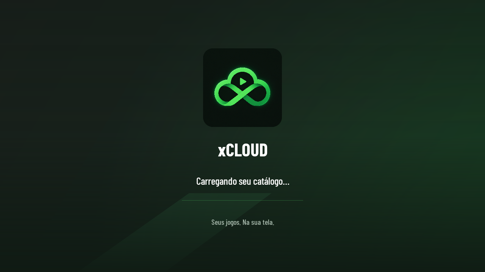
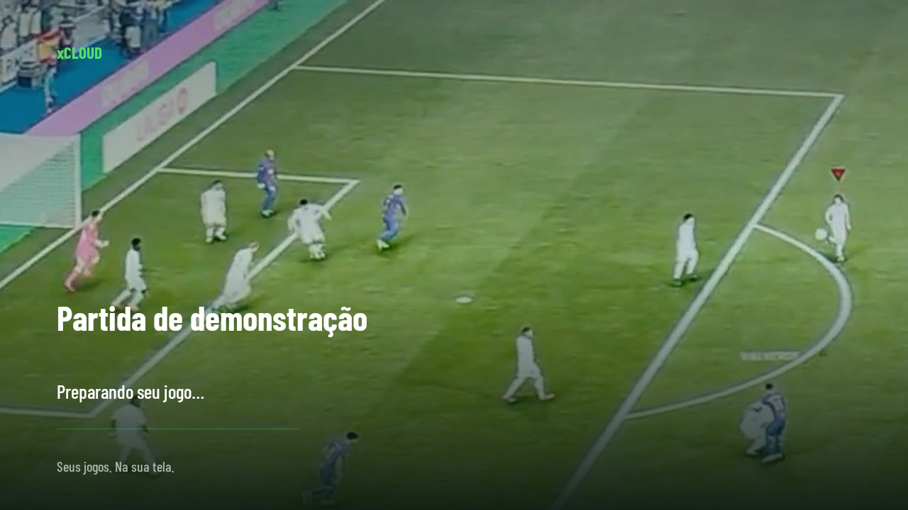
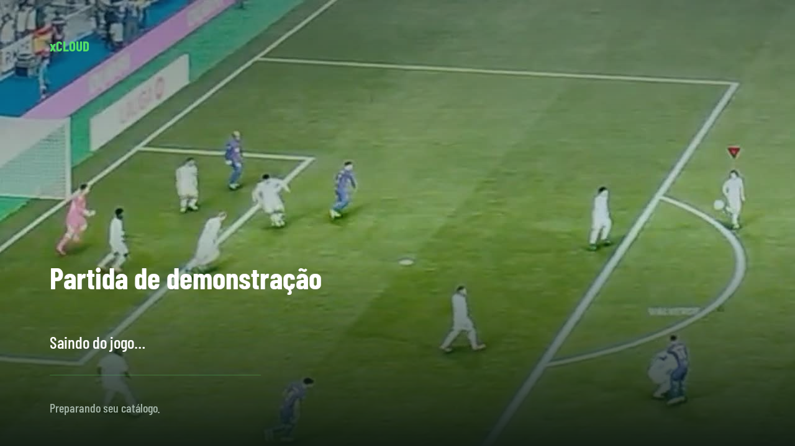

# Abertura e retorno ao catálogo — 0.27

A restauração da conta passa a usar uma tela nativa com a logo do xCLOUD. Ao abrir um jogo por atalho, essa tela apresenta a arte e o nome do título, quando disponíveis no cache público. As mensagens de conexão acompanham o estado real da conta; a fila mantém sua tela própria depois da validação do catálogo.

## Arte do jogo

`CatalogCache.artwork` recupera somente os dados visuais do título solicitado. A leitura ocorre fora da UI, sem novas consultas de catálogo ou restauração de capacidades de entrada/permissões. A lista autenticada continua sendo necessária para iniciar a partida.

O fundo prioriza hero/banner, depois tile e capa. O carregamento reutiliza o backend de imagens com requisição limitada a 1280×720, cache e decode fora da UI. Se não houver arte disponível, a logo e o fundo verde mantêm a identificação do aplicativo. A logo é decodificada em tamanho reduzido, fora da UI, e as imagens da transição são liberadas quando ela termina. Não há blur, leitura da superfície de vídeo ou desenho contínuo de novas imagens.

## Saída da partida

Ao desconectar, a transição mostra **Saindo do jogo…** com a arte do título. Ao cancelar a fila, mostra **Voltando ao catálogo…**. A mensagem amarela sobre fundo preto foi retirada desse fluxo.

O aplicativo oferece um quadro à UI antes da limpeza nativa de vídeo. A retomada do catálogo aguarda o encerramento do job da partida; a transição permanece sobre a tela até o primeiro desenho do catálogo, inclusive quando a grade ainda não havia sido criada porque a entrada ocorreu por atalho. Não há um tempo mínimo artificial de exibição.

Entradas repetidas pelo controle durante a saída são bloqueadas para evitar cancelamentos duplicados. Uma nova abertura válida por atalho substitui o retorno pendente. O diagnóstico pós-partida continua salvo e sua abertura automática aguarda o catálogo aparecer.

## Verificação

Os testes de integração exercitam restauração com autenticação ainda pendente, identificação visual por cache, entrada comum com logo, atalho sem arte, consulta somente do título escolhido e retorno ao catálogo aguardando um encerramento simulado. Também verificam cancelamento repetido e ausência de login/grade durante a entrada direta. Os testes de UI renderizam as transições e verificam o layout em paisagem até 4K.

As imagens desta página são capturas das views do aplicativo com dados de demonstração. O fundo do título usa um frame de gameplay já presente na galeria do repositório; no uso real, o aplicativo utiliza a arte do catálogo. A autenticação e o encerramento dos testes são simulados e não representam uma nova sessão física de streaming. O protocolo de toque, os HUDs e a política de entrada por dispositivo permanecem os da versão anterior.
