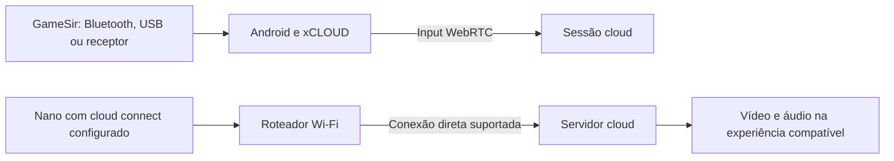

# Xbox Nano, GameSir Nova Lite e geração de quadros

Consulta às fontes: **5 de novembro de 2026**. Base do aplicativo: `7ce443adf2e942637032f68e3b112dfcb97f6ad1`, versão `0.30.0-resume-catalog`. Esta investigação atualiza as conclusões preliminares da 0.30; não adiciona uma função ao aplicativo.

## Conclusões verificadas

| Pergunta | Resultado e limite da evidência |
| --- | --- |
| O Xbox Nano conecta diretamente à nuvem por Wi-Fi? | **Sim.** O Xbox Wire anunciou a prévia de **cloud connect** em 4/11/2026, e o suporte oficial descreve a conexão direta aos servidores Xbox por Wi-Fi. A prévia está limitada aos EUA na documentação consultada. |
| Isso está descrito na ficha técnica geral? | A ficha consultada descreve Xbox Wireless e Bluetooth. Ela não apresenta a prévia Wi-Fi; sua omissão não basta para negar a função confirmada no anúncio e no suporte. |
| O GameSir T4 Nova Lite oferece esse recurso? | O produto e o manual documentam Bluetooth, receptor sem fio e cabo. Não foi encontrado modo Wi-Fi/IP ou suporte a cloud connect para esse modelo. Não houve inspeção física do chipset nem teste de firmware. |
| Uma atualização do xCLOUD transforma o GameSir em um Nano? | Não há caminho demonstrado para fazer isso somente no app. O Android pode encaminhar os eventos já recebidos, mas isso mantém o intermediário. A rota direta exige recursos do controle, firmware e associação aceita pelo serviço. |
| Interpolação no Android existe? | Sim: LSFG-Android e a integração do XStreaming são implementações públicas. Isso não demonstra benefício nos aparelhos modestos que executam este app. |
| Mali está totalmente excluída? | Não. O código atual do XStreaming contém adaptações explícitas para Mali, inclusive Mali-G57 MC2. Existência do caminho de código não equivale a benchmark ou compatibilidade universal. |

## Nano: operação e disponibilidade oficiais

Fontes primárias:

- [Ficha do Xbox Nano em português](https://www.xbox.com/pt-BR/accessories/controllers/xbox-nano-controller), destino final do link compartilhado pelo usuário.
- [Anúncio do controle, 14/10/2026](https://news.xbox.com/en-us/2026/10/14/xbox-nano-controller/).
- [Anúncio da prévia de cloud connect, 4/11/2026](https://news.xbox.com/en-us/2026/11/04/cloud-gaming-inputs-preview/).
- [Guia oficial: Use cloud connect with Xbox Cloud Gaming](https://support.xbox.com/en-US/help/hardware-network/controller/cloud-connect).

O anúncio de outubro e a ficha geral descrevem as conexões locais Xbox Wireless/Bluetooth. O anúncio de novembro acrescenta uma prévia: o Nano usa Wi-Fi para enviar os comandos diretamente ao servidor que executa o jogo, em vez de depender de Bluetooth com a TV. A Microsoft afirma que isso **pode** reduzir a latência de entrada; as fontes consultadas não fornecem um ganho numérico garantido.

O guia oficial informa:

1. Região atualmente atendida: **Estados Unidos**. A disponibilidade comercial do controle em outro país não confirma disponibilidade da prévia nesse país.
2. Controle: **Xbox Nano Controller**.
3. Configuração pelo **Xbox beta no Android/iOS** ou pelo **Xbox Accessories no PC**, neste último caso com participação no Xbox Insider/PC Gaming. No iOS, o beta depende de vagas no TestFlight.
4. No app de configuração, entrar com a conta Xbox usada para jogar e seguir o assistente de conexão do controle à rede Wi-Fi.
5. Abrir uma experiência compatível e entrar com **a mesma conta**. O guia também orienta usar o ícone de estado do controle e clicar em “Connect” quando necessário.
6. Dois toques rápidos no botão Pair alternam cloud connect e a conexão local mais recente. O padrão luminoso de batimento indica espera por uma experiência cloud compatível; luz contínua indica conexão com input funcionando.

A lista de experiências no guia consultado inclui **play.xbox.com**, o app Xbox em **TVs LG**, **TVs VIDAA**, **Fire TV** e **Meta Quest**. Não se deve estender essa lista automaticamente a qualquer Android TV, aplicativo independente ou país. Ela não confirma compatibilidade com este cliente xCLOUD.

O recurso de usar o telefone como controle da TV, anunciado na mesma publicação, é outra prévia. Ele não demonstra que qualquer controle Bluetooth passa a ter cloud connect.

### O que as fontes não estabelecem

O guia explica configuração, conta e troca de modos. Não especifica chipset, bandas Wi-Fi, formato de pacotes, endpoints de input, credenciais de provisionamento ou um SDK para controles de terceiros. Nas fontes examinadas, não foi localizado um contrato público suficiente para implementar a associação de um controle independente à sessão.

Também foram lidos estaticamente os **38 scripts iniciais** referenciados pelo HTML público de `https://www.xbox.com/en-US/play` nessa consulta, incluindo `8128.254147fc.chunk.js`. Não apareceu uma implementação identificável de cloud connect nesse conjunto. Isso é uma busca limitada: não inclui necessariamente chunks carregados após login, o app beta, Xbox Accessories ou firmware do Nano. Não demonstra inexistência de API. O método `createDirectConnectSession` encontrado nesse código pertence ao caminho de conexão a console; o nome não o torna uma implementação do Nano.

Não houve Nano físico, captura autenticada dessa função ou teste de partida com cloud connect nesta investigação.

## Aplicação ao GameSir T4 Nova Lite

Fontes primárias:

- [Produto e especificações](https://gamesir.com/products/gamesir-nova-lite/buy).
- [Manual oficial atual](https://gamesir.com/support/manuals/gamesir-nova-lite).
- [PDF oficial vinculado pelo manual](https://cdn.shopify.com/s/files/1/2241/8433/files/Manual-GameSir_Nova_Lite_EN.pdf?v=1743156237).
- [FAQ do produto](https://gamesir.com/support/faq?product=gamesir-nova-lite) e [downloads oficiais](https://gamesir.com/support/downloads?product=gamesir-nova-lite).

A ficha e o manual descrevem conexão em três modos: **Bluetooth, wireless dongle e cabo**. O manual ilustra o receptor USB ligado ao dispositivo e ensina pareamento Bluetooth com Android. Também documenta troca de modos XInput, NS Pro e Android nas conexões por receptor/cabo. Não descreve ingresso do controle no roteador, configuração Wi-Fi ou associação direta ao Xbox Cloud Gaming.

O FAQ mistura orientações específicas e gerais para famílias de controles. Seu conteúdo sobre “Wireless Debugging” para mapeamento de toque usa a rede do telefone; isso não é evidência de Wi-Fi no Nova Lite. Versões do GameSir App/GameHub publicadas na página de downloads também não são números de firmware do controle. Não foi encontrado changelog específico comprovando adição de cloud connect ao Nova Lite.

Não foi identificado o chipset por desmontagem nem auditado o firmware de uma unidade física. Portanto, a conclusão é **ausência de suporte documentado e de uma implementação demonstrada**, e não uma alegação de prova física sobre todos os componentes internos.

Para o GameSir, o app pode usar os eventos reconhecidos pelo Android, mapear botões/eixos e encaminhá-los pelo canal existente. O `RealtimeInputPump` já tem thread própria e antecipação de eventos: envio regular de 250 Hz no modo normal e 60 Hz no modo de compatibilidade. Esses valores não medem a taxa de rádio ou de leitura física do controle. Não há evidência para aumentar a taxa como suposta reprodução de cloud connect.

Um receptor GameSir não deve ser tratado como Xbox Wireless/GIP apenas porque ambos são sem fio. Compartilhar uma faixa de frequência não estabelece compatibilidade de protocolo nem capacidade Wi-Fi/IP.

Uma ponte externa poderia, em princípio, ler o controle por USB/Bluetooth e enviar comandos por uma interface de rede. Seria outro projeto, com hardware, autenticação, protocolo e associação à sessão a validar. No caso de cloud connect oficial, a interface para essa associação continua sem demonstração nesta pesquisa. A ponte não pode ser prometida como equivalente ao Nano, nem como redução garantida de atraso.

Mesmo com um Nano compatível, encurtar a rota dos comandos não elimina pausas no recebimento de vídeo nem o custo do decoder.

## Geração de quadros: implementações e custos encontrados

Snapshots de código consultados:

- [LSFG-Android, commit `da867e9`](https://github.com/FrankBarretta/LSFG-Android/blob/da867e918d65289ceb38f75e354b197dc08ffd29/README.md).
- [XStreaming, commit `06ef1c7`](https://github.com/Geocld/XStreaming/tree/06ef1c7ee01d09cf9bb2a97fc4895da85e8488a8), incluindo o README, exportação de frames, inicialização Vulkan e apresentação.

O LSFG-Android documenta um pipeline Vulkan/AHardwareBuffer e funcionamento em Adreno 7xx ou mais recentes. O app externo usa captura MediaProjection e overlay. A estimativa de 50–80 ms adicionais citada pelo README pertence a essa arquitetura e é uma afirmação do projeto, sem medição independente nesta investigação. Não deve ser aplicada como medida de uma integração interna no xCLOUD.

O projeto depende de shaders extraídos de uma cópia legítima de `Lossless.dll`, fornecida pelo usuário. O XStreaming declara a mesma dependência. Não há DLL nem shaders proprietários incorporados a este repositório por esta investigação.

O XStreaming contém integração interna nativa com WebRTC: [`FrameGenExportProcessor.java`](https://github.com/Geocld/XStreaming/blob/06ef1c7ee01d09cf9bb2a97fc4895da85e8488a8/android/app/src/main/java/com/xstreaming/framegen/FrameGenExportProcessor.java) exporta texturas GLES para outra Surface; [`LsfgRuntime.java`](https://github.com/Geocld/XStreaming/blob/06ef1c7ee01d09cf9bb2a97fc4895da85e8488a8/android/app/src/main/java/com/xstreaming/framegen/LsfgRuntime.java) exige Android 10+ e prepara os shaders. Isso demonstra uma arquitetura possível sem capturar a tela e sem adicionar WebView. Ainda envolve JNI, processamento e sincronização entre APIs gráficas.

### Mali e o caminho de apresentação

[`device.cpp`](https://github.com/Geocld/XStreaming/blob/06ef1c7ee01d09cf9bb2a97fc4895da85e8488a8/android/app/src/main/cpp/lsfg_vendor/framegen/src/core/device.cpp) enumera extensões e recursos Vulkan e implementa caminhos de compatibilidade. Há tratamento explícito para dispositivos sem synchronization2, com comentário citando Mali-G57 MC2 e Vulkan 1.1.177. Portanto, “toda Mali é incompatível” não é uma conclusão sustentada por esse código. Também não se deve exigir FP16 indiscriminadamente: o código consulta esse recurso e possui caminhos condicionais.

Há, porém, um limite concreto no snapshot: [`lsfg_render_loop.cpp`](https://github.com/Geocld/XStreaming/blob/06ef1c7ee01d09cf9bb2a97fc4895da85e8488a8/android/app/src/main/cpp/lsfg_vendor/app/lsfg_render_loop.cpp#L528) fixa **`kEnableWsiSwapchain = false`**. O caminho de saída Vulkan direto está desativado, e a apresentação passa pelo fallback com acesso/cópia pela CPU. Os comentários descrevem problemas de driver e de integração da janela. São evidências de código e relatos dos autores, não testes realizados aqui. Copiar essa integração não demonstra um caminho sem cópias ou leve para uma TV modesta.

A [documentação do Android sobre AHardwareBuffer](https://developer.android.com/ndk/reference/group/a-hardware-buffer) permite interop EGL/OpenGL/Vulkan, mas compartilhar o buffer sem cópia não torna automaticamente todas as etapas do pipeline sem cópia. O suporte precisa ser confirmado no driver e na implementação de apresentação. API Android, nome da GPU ou anúncio de suporte a Vulkan isoladamente não comprovam desempenho suficiente.

### Benefício possível e hipóteses

| Abordagem | O que oferece | Limite para aparelhos modestos |
| --- | --- | --- |
| Interpolar uma fonte estável de 30 para 60 FPS | Pode criar posições intermediárias e suavizar o movimento em uma tela de 60 Hz. | Exige estimação de movimento, buffers, sincronização e orçamento de GPU/CPU. Não torna o jogo remoto uma simulação de 60 FPS. |
| Integração interna LSFG | Evita a captura externa da tela. Há exemplo de código no XStreaming. | Ainda exige adaptar o renderer, fornecer shaders, verificar recursos e medir o caminho completo. O fallback de apresentação observado merece atenção especial. |
| Fluxo óptico em resolução menor / modo de desempenho | É uma hipótese de redução de custo; LSFG oferece parâmetros relacionados. | Não foi medido benefício nos aparelhos alvo. Reduzir custo pode degradar detalhes, HUD e movimento. |
| Mistura transparente ou repetição de quadros | Custo conceitualmente menor. | Produz imagens duplas ou repete a posição anterior; não equivale a interpolação de movimento nem justifica anunciar FPS gerados. |
| Melhor distribuição dos quadros existentes | Pode reduzir irregularidade de apresentação sem estimar novos movimentos. | Frame pacing não é geração de quadros. Exige identificar um problema real de apresentação antes de mudar o agendamento. |

O orçamento de apresentação de uma tela de 60 Hz é aproximadamente 16,7 ms por atualização. Um único buffer RGBA8 de 1280×720 contém 3.686.400 bytes, cerca de 3,52 MiB, antes de considerar outras imagens, pirâmides de movimento e recursos temporários. São cálculos geométricos, não medidas de tempo ou memória do app em um aparelho.

A [documentação de frame pacing do Android](https://developer.android.com/games/sdk/frame-pacing) explica sincronização, filas e backpressure; não promete interpolação. O renderer deste app já usa o caminho nativo WebRTC/SurfaceViewRenderer. Não basta adicionar Swappy ou Choreographer para produzir quadros novos, e uma nova fila pode aumentar atraso.

O limite de apresentação de 30 FPS do modo de compatibilidade não garante que o servidor envie ou que o decoder processe somente 30 quadros por segundo. Um experimento de 30 para 60 precisa verificar a cadência da fonte real; descartar quadros já decodificados não prova economia no decoder.

Não foram medidos GPU, driver, consumo, aquecimento ou apresentação real nas TVs e celulares alvo nesta investigação. A [ficha oficial do Helio G99](https://www.mediatek.com/products/smartphones/mediatek-helio-g99) identifica Mali-G57 MC2; isso não substitui identificar o hardware/driver da unidade em teste nem comprova ganho com LSFG. Modelos e variantes de TVs também precisam ser identificados antes de atribuir capacidades gráficas.

Interpolação não reconstrói indefinidamente uma partida que deixou de entregar imagens. Também pode gerar artefatos em texto, mira, menus e objetos descobertos pelo movimento. Uma mudança na rota do controle não resolve essas limitações visuais.

## Decisão para o aplicativo e verificação necessária

Esta entrega registra pesquisa e fontes. O aplicativo continua na **0.30**, com o motor nativo, o histórico da conta, atalhos, HUDs, toque nativo, áudio, diagnósticos e assinatura fixa existentes. Não foi criado um botão de cloud connect para o GameSir nem ativada interpolação por padrão. Não há novo APK nesta entrega.

Um próximo experimento de interpolação, se solicitado, deve começar separado do caminho padrão: verificar recursos reais, usar fonte estável de 30 FPS, medir o custo completo de geração e apresentação e comparar com o renderer atual. Deve manter fallback e liberação dos recursos ao sair. Os contadores precisam separar quadros recebidos, decodificados, gerados e efetivamente apresentados. A geração deve ser suspensa quando o fluxo real parar. Não se deve aumentar fila ou atrasar o input para esconder falta de capacidade.

Para cloud connect no cliente nativo, ainda faltam uma interface de associação demonstrada, uma experiência/região habilitada e um Nano físico para validação. Para aproveitar a rota diretamente no Nova Lite, faltam também suporte documentado do próprio controle ou uma ponte externa comprovada. Uma hipótese de implementação não autoriza anunciar compatibilidade.

## Rastreabilidade da consulta

O link compartilhado foi resolvido por HTTP até a ficha oficial. O guia de suporte usa JavaScript; seu conteúdo foi lido pelo endpoint público utilizado pelo próprio frontend, `content.support.xboxlive.com/content`, com `path=/SXC/hardware-network/controller/cloud-connect`, `language=en-US` e `market=US`, sem sessão de usuário. Esse é um endpoint de **documentação**, não de controle da partida.

O manual GameSir foi lido no conteúdo serializado do site e no PDF vinculado. A análise dos projetos de geração foi estática, nos commits indicados. Não houve execução desses projetos externos, login em contas de teste, leitura de credenciais ou teste físico. Nenhum diagnóstico pessoal ou identificador de conta foi incluído neste documento.
